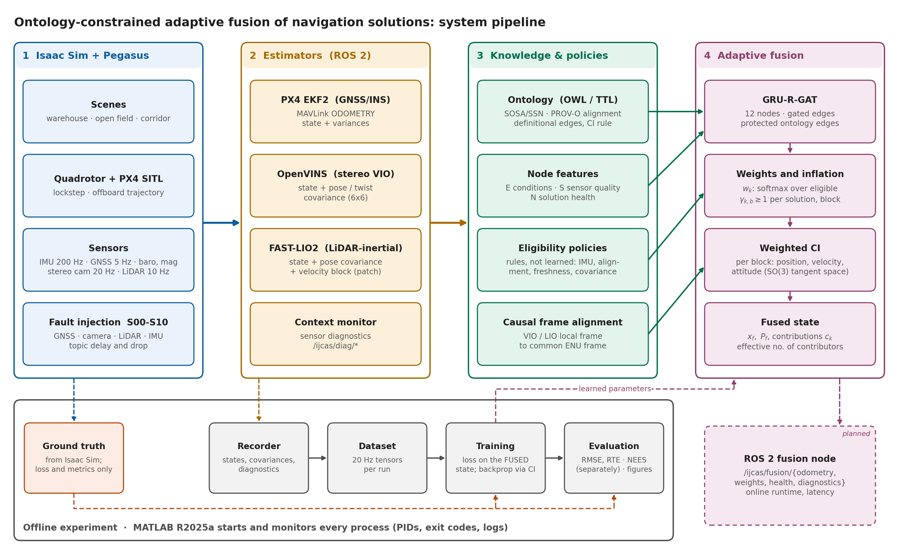
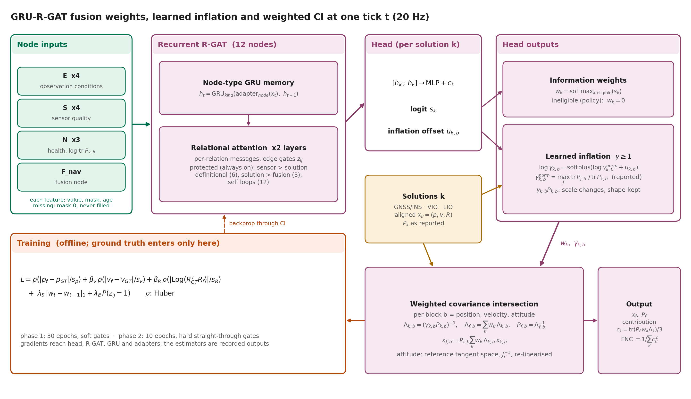
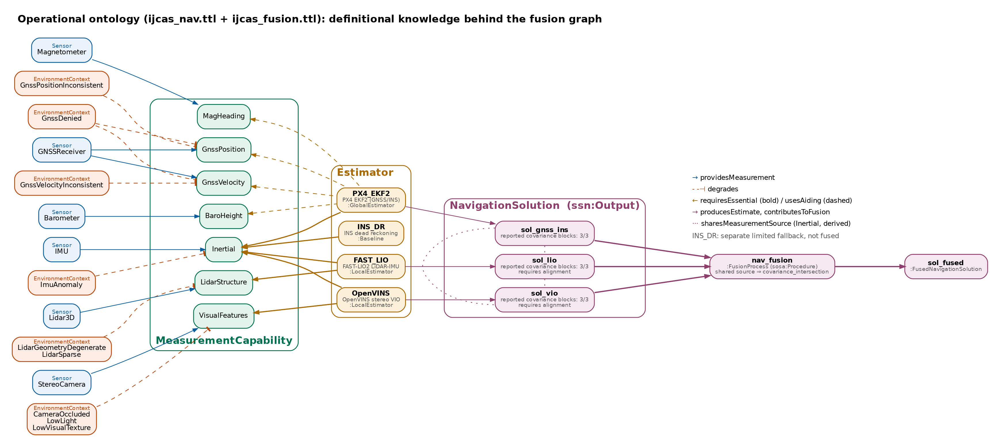
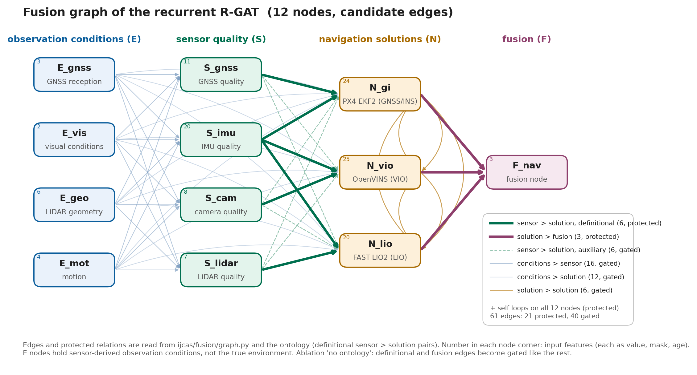
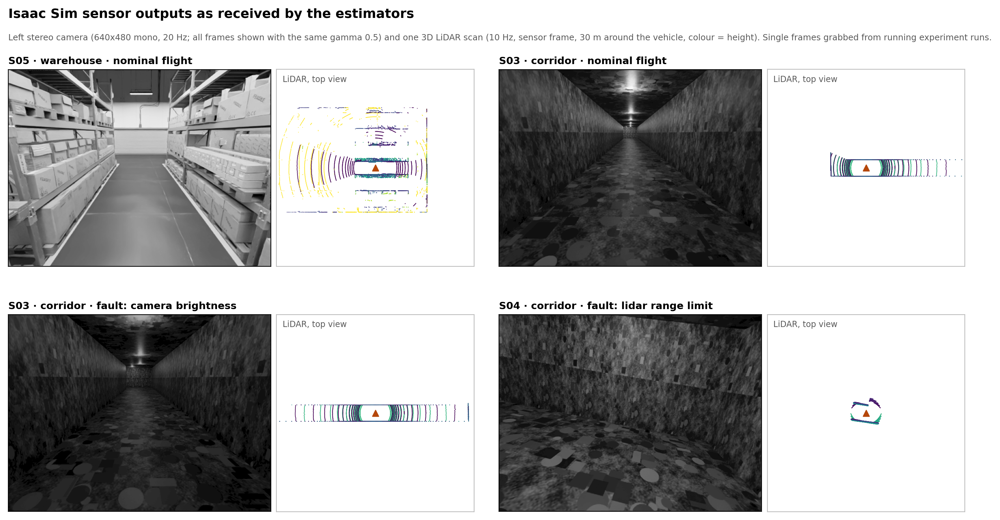

# 온톨로지 제약 기반 다중 항법 해 적응형 융합

무인 항공기(쿼드로터)에서 서로 다른 센서 조합에 의존하는 세 항법 해의 추정값을 매 시점 하나의 항법 출력으로 융합한다.
세 항법 해와 그 추정기는 다음과 같다.

- GNSS/INS: PX4 EKF2
- 스테레오 VIO: OpenVINS
- LiDAR-관성: FAST-LIO2

출력은 위치·속도·자세와 그 공분산이다.
융합 가중치와 공분산 팽창 계수는 순환 관계 그래프 어텐션망(GRU–R-GAT)이 정한다. 이 망의 그래프 구조는 운용 온톨로지가 제약한다.
계산된 가중치로 추정값을 결합하는 방법은 공분산 교차(CI)이다.
학습은 융합된 상태와 참값 사이의 오차를 손실로 삼아 CI를 거쳐 역전파한다.
실험은 Isaac Sim에서 결함을 주입한 비행 시나리오로 수행한다.



---

## 1. 문제 설정

- **항법 해마다 열화 조건이 다르다.**
  - GNSS/INS: GNSS 차단과 위치 편향에 약하다.
  - VIO: 저조도, 가림, 흐림에 약하다.
  - LIO: 기하 퇴화, 거리 제한, 점 손실에 약하다.
  - 센서 메시지의 지연·손실과 IMU 이상은 세 해 모두에 영향을 준다.

  해 하나만 고르면 그 해가 열화되는 순간 출력이 함께 나빠진다.
  그래서 여러 해를 시점마다 다른 비중으로 결합하는 추정값 수준 융합을 택한다.
- **세 해는 같은 IMU를 쓴다.** 따라서 오차가 크기를 알 수 없는 만큼 서로 상관되어 있다.
  정보 행렬을 독립인 것처럼 더하면 공통 부분을 중복으로 센다. 그래서 상관을 몰라도 쓸 수 있는 공분산 교차(CI)를 사용한다.
- **공분산은 추정기가 실제로 보고한 값만 쓴다.**
  - PX4: MAVLink `ODOMETRY`의 위치·자세·속도 분산
  - OpenVINS: 자세·속도 6×6 공분산
  - FAST-LIO2: 자세 6×6 공분산, 그리고 어댑터 패치로 내보낸 속도 블록

  보고되지 않은 블록은 그 블록의 융합에서 빠진다. 다른 값으로 대체하지 않는다.
- **참값(GT)은 학습 손실과 평가 지표에만 쓴다.** 실행 중 입력으로는 쓰지 않는다.

## 2. 제안 방법



### 2.1 운용 온톨로지



`ijcas/knowledge/ijcas_nav.ttl`과 `ijcas_fusion.ttl`(OWL/Turtle)은 정의적 지식을 기술한다. 대상은 센서, 측정 능력, 추정기, 항법 해, 융합 과정이다.
실행 중에 바뀌는 값(가중치, 적격성 판정)은 온톨로지에 넣지 않는다. 온톨로지는 융합에서 다음 세 가지로 쓰인다.

1. **그래프 제약.** 추정기가 쓰는 측정(필수 `requiresEssential`, 보조 `usesAiding`) 가운데 그래프의 센서 노드에 해당하는 것에서 센서→항법 해 정의 간선 6개가 나온다.
   여기에 항법 해→융합 노드 간선 3개를 더한 9개는 학습으로 끌 수 없는 보호 간선이다.
2. **융합 방식.** 세 해가 같은 측정 능력(Inertial)을 공유한다(`sharesMeasurementSource`).
   이 경우 융합 과정에는 공분산 교차가 요구된다(`requiresMethodUnderSharedSource`).
3. **공분산 가용성.** 블록마다 추정기가 보고하는지(`reportedByEstimator`) 기록한다.
   보고된 블록만 CI에 들어간다.

상위 개념은 SOSA/SSN과 PROV-O에 맞췄다. 예를 들어 항법 해는 `ssn:Output`, 융합 과정은 `sosa:Procedure`이다.

### 2.2 융합 그래프와 순환 R-GAT



- **노드 12개:**
  - 관측 조건 E 4개: GNSS 수신, 시각 조건, LiDAR 기하, 운동
  - 센서 품질 S 4개: GNSS, IMU, 카메라, LiDAR
  - 항법 해 N 3개
  - 융합 노드 F 1개

  E 노드에는 실제 환경이 아니라 센서 진단에서 얻은 관측 조건이 들어간다.
- **노드 입력:**
  - 각 특징은 (값, 마스크, 나이) 세 개로 표현한다. 값이 없으면 마스크를 0으로 두고 채워 넣지 않는다.
  - 항법 해 노드에는 보고된 공분산 블록의 log 대각합이 더해진다.
  - 융합 노드 입력은 세 가지이다: 적격한 해의 수, 위치 공분산을 보고한 해의 수, 적격한 해들 사이의 최대 위치 불일치.
- **간선:**
  - 후보 간선은 61개이고, 그중 보호 간선이 21개(정의 간선 6, 해→융합 3, 자기 루프 12)이다.
  - 나머지 40개는 학습되는 이진 게이트로 켜고 끈다.
  - 학습 1단계에서는 연속 게이트를 쓰고, 2단계에서는 직통 추정기(straight-through)로 이진 게이트를 학습한다.
  - 운용할 때는 이력(hysteresis)이 있는 이진 게이트를 쓴다.
- **망 구조:**
  - 노드 종류별 GRU 메모리 위에 관계별 어텐션 2층(은닉 32, 헤드 2)을 쌓는다.
  - 해 k마다 헤드가 [h_k ; h_F]로부터 두 가지를 낸다: 가중치 logit s_k, 그리고 블록별 팽창 오프셋 u_k,b.

### 2.3 가중치, 공분산 팽창, 공분산 교차

- **정보 가중치:**
  - 적격한 해들에 대해 w_k = softmax(s_k)이다.
  - 적격성은 정책 규칙으로 정하며 학습 대상이 아니다. 부적격한 해는 w_k = 0이다.
- **공분산 팽창:** 블록 b ∈ {위치, 속도, 자세}마다 다음과 같이 계산한다.
  - log γ_k,b = softplus(log γ^norm_k,b + u_k,b)
  - γ^norm_k,b = max_j tr P_j,b / tr P_k,b
  - 이 식에서 다음이 성립한다.
    - γ ≥ 1이다.
    - 공분산의 모양(성분 비율과 교차항)은 그대로 두고 크기만 키운다.
    - u = 0이면 보고된 공분산의 크기를 서로 맞춘 CI가 된다.
- **가중 공분산 교차:** 블록마다 다음과 같이 계산한다.
  - Λ_k,b = (γ_k,b P_k,b)⁻¹
  - P_f,b = (Σ_k w_k Λ_k,b)⁻¹
  - x_f,b = P_f,b Σ_k w_k Λ_k,b x_k,b
  - 자세는 기준 자세의 접공간에서 계산한다. 이때 J_r⁻¹로 공분산을 옮기고 다시 선형화한다.
  - 블록 사이의 교차 공분산은 쓰지 않는다. PX4가 이를 보고하지 않기 때문이다.
- **진단량:** 해 k가 융합 위치에 실제로 기여한 정도는 c_k = tr(P_f w_k Λ_k)/3이다.
  유효 기여 해 수는 1/Σc_k²이다. 둘 다 가중치 w_k와 따로 보고한다.

### 2.4 적격성 정책과 좌표 정렬

- **적격성:**
  - 출력 나이, 보조 측정의 나이, 정렬 유효성, IMU 수신을 규칙으로 검사한다.
  - IMU 수신 조건은 최근 1 s 동안 150 Hz 이상이다.
  - INS 추측항법은 융합 입력에 넣지 않는다.
- **좌표 정렬:** VIO·LIO는 각자의 국소 좌표계로 출력하므로 공통 좌표계(PX4 국소 ENU)로 옮겨야 한다.
  - 기준(PX4 전역 위치)을 쓸 수 있는 동안 최근 30 s의 위치 쌍으로 4자유도(요·평행이동) 변환을 맞춘다.
  - 이동 거리가 10 m 이상일 때만 그 변환을 받아들인다.
  - 기준을 쓸 수 없게 되면 변환을 고정한다.
  - 자기 속도와 맞지 않는 1 m 넘는 위치 도약은 리셋으로 보고, 정렬을 무효로 한다.
  - 정렬에는 과거 데이터만 쓴다.

### 2.5 학습

- **손실:**
  - 기본항: L = ρ(|p_f − p_GT|/1 m) + 0.5 ρ(|v_f − v_GT|/0.5 m/s) + 0.5 ρ(|Log(R_GTᵀR_f)|/5°)
    - p_f, v_f, R_f는 각각 융합된 위치, 속도, 자세이다.
    - ρ는 Huber 함수이다.
  - 정규화항: λ_S‖w_t − w_{t−1}‖₁(적격 집합이 바뀌지 않은 시점만, λ_S = 0.1)과 λ_E P(간선 켜짐)
- **기울기 경로:** 기울기는 CI를 거쳐 헤드, R-GAT, GRU, 입력 어댑터로 흐른다. 추정기는 기록된 출력이므로 학습되지 않는다.
- **학습 일정:**
  - 1단계: 30 에폭, 연속 게이트, λ_E = 0
  - 2단계: 10 에폭, 이진 게이트, λ_E = 0.1
- **최적화:**
  - Adam, 학습률 2·10⁻³, 기울기 노름 1로 제한
  - 실행 전체를 200틱(10 s) 단위의 절단 BPTT로 학습한다.
  - 모델마다 무작위 시드 3개로 학습한다.

## 3. 실험 설정

### 3.1 시뮬레이션과 추정기

| 항목 | 설정 |
|---|---|
| 시뮬레이터 | Isaac Sim 5.1 + Pegasus Simulator 5.1.0, 물리 200 Hz, 렌더링 20 Hz |
| 기체 | Iris 쿼드로터 모델. 장면별 기준 루프 궤적을 강제로 따른다(forced motion). PX4는 lockstep SITL로 추정기 역할만 한다 |
| GNSS/INS | PX4 v1.14.3 EKF2 (MAVLink `ODOMETRY` 50 Hz, NED → ENU 변환) |
| VIO | OpenVINS v2.7, 스테레오 |
| LIO | FAST-LIO2 (hku-mars, `cc3c9e8`) + 속도 공분산 출력 어댑터 패치 (`config/engines/fast_lio/`) |
| 미들웨어 | ROS 2 Humble |
| 실험 운영 | MATLAB R2025a (`matlab/`)가 시뮬레이터·추정기·학습 프로세스를 시작하고 PID, 종료 코드, 로그를 관리한다 |

### 3.2 센서

| 센서 | 사양 |
|---|---|
| IMU | 200 Hz. 자이로 잡음 밀도 1.87·10⁻⁴ rad/s/√Hz, 가속도 잡음 밀도 1.86·10⁻³ m/s²/√Hz, 바이어스는 Gauss-Markov 모델 |
| GNSS | 5 Hz 위치·속도 |
| 기압계, 지자기 | 50 Hz |
| 스테레오 카메라 | 640×480 mono, 20 Hz, 수평 시야각 90°, 기선 0.12 m |
| 3D LiDAR | Ouster OS1 32채널 RTX 모델, 10 Hz 스캔 |



### 3.3 장면과 시나리오

장면은 세 가지이다.

- **warehouse:** 선반 통로가 있는 실내
- **open field:** 높이 1–6 m의 상자와 원기둥 40개가 흩어진 200 m 야외. 비행 고도 3–10 m
- **corridor:** 너비 5 m, 높이 4 m의 사각 고리형 복도. 반복 무늬가 있다

시나리오는 S00–S10이다.

- 각 실행은 180 s이다. 처음 20 s 이상은 정상 비행(정지 비행 8 s + 가속 4 s + 순항)이다.
- 결함은 40–70 s 사이에 시작하고, 시작 시각은 시드로 정한다. 결함의 종류와 수준도 시드로 정해진다.

| ID | 결함 |
|---|---|
| S00 | 없음 (정상 비행) |
| S01 | GNSS 차단 10 / 30 / 60 s |
| S02 | GNSS 위치 편향 3 / 5 / 10 m (5 s 램프, 60 s). 일부는 GNSS 속도 무효를 동반 |
| S03 | 카메라 밝기 0.5 / 0.2배, 85 % 가림, 31 px 흐림 (40 s) |
| S04 | LiDAR: 복도에서 거리 5 m 제한, 점 손실 100 %, 거리 3 m 제한 (40 s) |
| S05 | warehouse에서 GNSS 차단 50 s + 카메라 밝기 0.2배 또는 가림 |
| S06 | corridor에서 GNSS 차단 50 s (+ 일부 LiDAR 점 손실 90 %) |
| S07 | 카메라·LiDAR 메시지 지연 20 / 50 / 100 ms와 20 % 손실, GNSS 메시지 지연 (60 s) |
| S08 | GNSS 차단 + 카메라 완전 가림 + LiDAR 완전 손실 30 s (일부 기압계·지자기 손실 동반) |
| S09 | 별도 장면(office)의 결함 조합. 개발 데이터에 넣지 않는다 |
| S10 | IMU: 자이로 바이어스 계단 0.05 rad/s, 가속도 바이어스 계단 0.4 m/s², 시각 오프셋 30 ms, 포화(±0.25 rad/s, ±12 m/s²) (50 s) |

### 3.4 데이터와 분할

- **개발 데이터:** 시드 1–10 × 시나리오 10개(S09 제외), 모두 100회 실행이다.
  - 각 실행에서 추정기 출력, 보고 공분산, 센서 진단, 참값을 기록해 20 Hz 텐서로 만든다.
  - 원시 센서 데이터는 저장하지 않는다.
- **분할:** 시드 기준으로 미리 정해 두었다.
  - 검증: 시드 1, 3, 6, 8 (40회). S10의 IMU 결함 네 종류가 모두 들어간다.
  - 학습: 시드 2, 4, 5, 7, 9, 10 (60회)
- **시험 데이터:** 개발 데이터와 다른 시드로 따로 수집한다. 모델과 설정을 모두 고정한 뒤 한 번만 평가한다.

### 3.5 비교 방법과 절제 실험

비교 방법은 모두 같은 상태, 같은 적격성, 같은 보고 공분산을 쓴다.

| 비교 방법 | 내용 |
|---|---|
| 단일 해 | GNSS/INS, VIO, LIO를 각각 하나만 사용 |
| 동일 가중 평균 | 공분산을 무시한 산술 평균 |
| 동일 가중 CI | 보고된 공분산으로 w_k를 모두 같게 둔 CI |
| 일반 CI | 위치 공분산 대각합을 최소화하는 w (단체 위 격자 탐색) |
| 크기 정규화 CI | γ^norm만 적용 (u = 0, 학습 없음) |
| 독립 정보 융합 | Σ P_k⁻¹. 공유 IMU를 중복으로 센다 |
| GT 단일 해 오라클 | 매 시점 참값 오차가 가장 작은 해 (참고용 상한) |

절제 실험 변형은 다음과 같다. 입력, 적격성, 공분산은 제안 방법과 같다.

| 변형 | 바뀌는 점 |
|---|---|
| `rgat` | 제안 방법 |
| `rgat_A` | 팽창 없이 보고 공분산 그대로 사용 (가중치만 학습) |
| `rgat_noonto` | 온톨로지 제약 제거 (정의 간선과 융합 간선도 게이트로 학습) |
| `rgat_block` | 해와 블록마다 가중치를 따로 학습 |
| `rgat_nomem` | 노드 메모리를 매 시점 초기화 |
| `rgat_dense` | 게이트 없이 모든 후보 간선 사용 |
| `rgcn` | 어텐션 대신 게이트가 있는 R-GCN 집계 |
| `gru` | 그래프 없이 모든 노드 입력을 이어 붙인 GRU (은닉 96) |

### 3.6 평가 지표

평가는 정상 구간(처음 20 s) 이후를 대상으로 한다. 정확도와 공분산 일관성은 따로 보고한다.
가중치를 데이터에 맞춰 학습하면 CI의 보수성이 보장되지 않기 때문이다.

- **정확도:**
  - 위치·속도·자세 RMSE, 위치 오차 95 백분위와 최댓값
  - 10 s 구간 상대 위치 오차(RTE)
  - 가용도: 출력이 있고 오차가 2 m 이하인 시간 비율
  - 출력이 없는 시간, 출력 불연속
- **일관성:** 위치 NEES의 평균, 그리고 χ²₀.₉₅(3) = 7.815를 넘는 비율
- **융합 진단:** 평균 가중치 w_k, 실제 기여도 c_k, 유효 기여 해 수, 팽창 계수 log γ

## 4. 실행

```bash
source env/ijcas_env.sh                                       # ROS 2 Humble, 작업 공간, 데이터 경로

# 수집: 시나리오 배치 (재시작 가능, Isaac Sim + PX4 + 추정기 + 기록기)
python3 tools/run_batch.py --set fusion_dev

# 융합 데이터셋 (실행마다 20 Hz 텐서 하나)
python3 tools/fusion_build_dataset.py --set fusion_dev --workers 6

# 학습과 검증 평가
python3 tools/fusion_run.py train --set fusion_dev --variants rgat,gru --seeds 0,1,2
python3 tools/fusion_run.py eval  --set fusion_dev --split val
```

MATLAB R2025a에서는 `matlab/ijcas_main.m`이 같은 명령을 별도 프로세스로 실행한다. 로그는 `results/fusion/logs`에 남는다.

```matlab
cd matlab
ijcas_main(Steps=["setup" "status" "inspect"])   % 환경 점검, 수집 진행 상황, 공분산 기록 점검
```

## 5. 저장소 구조

| 경로 | 내용 |
|---|---|
| `isaac/` | Isaac Sim 월드, 센서, 결함 주입, PX4 연동, 장면 |
| `ros2/` | 기록기, 센서 진단(context monitor) |
| `config/` | 장면, 추정기 설정, FAST-LIO2 어댑터 패치, 적격성 임계값 |
| `ijcas/fusion/` | CI, 공분산 블록, 데이터셋, 융합 그래프, 모델, 학습, 평가 |
| `ijcas/knowledge/` | 운용 온톨로지 (TTL) |
| `ijcas/rgat/`, `ijcas/selector/` | 노드 특징, 적격성 정책, 그래프 기반 모듈 |
| `ijcas/scenarios.py` | 시나리오 S00–S10 정의 |
| `tools/` | 수집, 데이터셋, 학습·평가, 그림 생성 스크립트 |
| `matlab/` | MATLAB R2025a 실험 운영 |
| `tests/` | 단위 테스트 (`python3 -m pytest tests`) |
| `docs/figures/` | 이 문서의 그림과 생성 방법 |

그림 생성 방법과 각 그림의 설명은 [docs/figures/README.md](docs/figures/README.md)에 있다.
