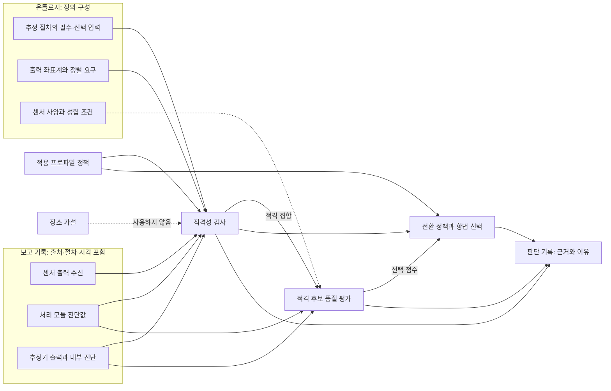

# IJCAS 항법 선택 재설계: 사실·관측·판단을 분리한 온톨로지와 검증 계획

- 작성: 2026-11-18
- 기준 코드: 커밋 `878eac1`(로컬 HEAD와 `origin/main`이 같음을 확인)
- 함께 둔 초안: [docs/ontology_v2/](ontology_v2/)
  - 공통부·항법·환경 모듈, IJCAS 적용 프로파일, 구성, 실행 기록 예시, SHACL 규약
  - 검증 스크립트 [validate_examples.py](ontology_v2/validate_examples.py)

표기는 다음과 같이 구분한다.

| 표기 | 뜻 |
|---|---|
| **[구현]** | 기준 커밋의 코드·설정·기록에서 직접 확인한 사실 |
| **[제안]** | 이번 설계 제안. 구현·평가하지 않았다 |
| **[결과]** | 기존 실험의 검증된 결과. 출처를 함께 적는다 |
| **[검증]** | 이번 작업에서 실행해 확인한 것 |
| **[미확인]** | 확인하지 못한 것. 추정으로 채우지 않았다 |

---

## 요약

1. **[구현] 의존 관계와 후보 제외가 서로 다른 곳에 구현돼 있다.**
   - 온톨로지의 필수 입력(`requiresEssential`)은 Ontology-K에서만 후보 제외로 이어진다.
   - 학습 선택기의 적격성은 `features.py`에 따로 구현돼 있다. 기준 커밋에는 IMU 상태 검사가 없었다.
     2026-11-18에 IMU 수신 검사를 모든 선택기에 추가했다(7.6절).
   - R-GAT의 '보호 간선'은 메시지 전달 경로일 뿐, 후보 제외와는 관계가 없다.
2. **[구현] R-GAT의 '환경 노드'에는 실제 환경 정보가 없다.**
   - 영상 밝기, 점군 고유값 비, 수신기가 보고한 σ, IMU 통계처럼 센서 자료에서 계산한 진단값이 들어 있다.
   - 학습 목표는 참값 오차가 가장 작은 적격 후보를 고르는 것이다. 간선 게이트와 attention에는 직접 감독이 없다.
3. **[구현] 비교 방법들의 운용 조건이 같지 않다.**
   - 판단 주기가 20 Hz와 10 Hz로 다르다.
   - INS 기준점을 다시 잡는 방식과 적격성 규칙이 서로 다르다.
   - 따라서 기존 학습 대 규칙 비교([결과] 1.127 m 대 2.029 m·5.843 m)에는 선택 논리 이외의 차이도 섞여 있다. 그 크기는 [미확인]이다.
4. **[제안] 정보를 다섯 종류로 저장하고, 판단은 보고 기록을 근거로만 참조한다.**
   - 다섯 종류: 정의·의존 관계, 구성·사양, 관측·보고 기록, 정책, 판단·선택 결과.
   - 판단은 보고 기록을 `prov:used`로만 참조한다.
   - 적격성은 프로파일 정책 하나(공용 적격성 관문)로 모든 선택기에 같게 적용한다.
   - 장소 가설은 보관만 하고 제외 근거로 쓰지 않는다.
5. **[검증] 초안의 Turtle과 SHACL 규약을 pyshacl 0.40.2로 검증했다(11건 모두 기대대로).**
   - 정상 예시는 통과한다.
   - 다음 네 가지 위반은 검출된다.
     - 값도 상태도 없는 관측
     - 판단 이후에 수신된 기록을 사용한 판단
     - 장소 가설을 쓴 적격성 판단
     - 값과 '계산 불가' 상태를 함께 가진 관측
   - UWB 센서와 펌프 감시 도메인을 추가해도 기존 규약과 질의 결과가 바뀌지 않았다.

---

## 1. 핵심 설계

### 1.1 현재 구현 확인 결과 [구현]

| 확인 항목 | 확인 결과 | 근거 |
|---|---|---|
| **온톨로지 필수 입력과 코드 적격성의 일치** | **일치하지 않는다.** 적격성 구현이 세 갈래다.<br>① Ontology-K: `requiresEssential` 측정 상태가 Unusable 또는 Unknown이면 제외한다(IMU 포함). 출력 경과 > 0.3 s도 제외한다.<br>② 학습 선택기·Oracle·F-\*: 다음 다섯 조건으로 판정한다. **IMU 상태는 없다.** VIO는 영상 단위 지표(VisualFeatures)가 아니라 OpenVINS 추적 특징 수로 판단한다.<br>　· 출력 경과 ≤ 0.3 s<br>　· 정렬 성립<br>　· 마지막 GNSS fix 이후 ≤ 5 s<br>　· OpenVINS 추적 특징 ≥ 4 수신 이후 ≤ 1 s, LiDAR 점 ≥ 1500 수신 이후 ≤ 1.5 s<br>　· INS 고정점 이후 ≤ 10 s<br>③ H-FSM: GNSS fix ≤ 1 s, 출력 경과 < 0.3 s, 정렬 성립.<br>동결 임계값에서는 영상 단위 지표(특징 수·격자·밝기·스테레오)와 LiDAR 점 수·고유값 비에 임계가 없다. 그래서 '영상 밝기 낮음 → VIO 제외'는 동결판에서 작동하지 않는다. 초기판(`thresholds.yaml`)에는 이 임계가 있었다. | [ontology.py:147-164](../ijcas/selector/ontology.py#L147-L164)<br>[features.py:144-155](../ijcas/rgat/features.py#L144-L155)<br>[engine.py:279-287](../ijcas/selector/engine.py#L279-L287)<br>[thresholds_validated.yaml:49-90](../config/selector/thresholds_validated.yaml#L49-L90) |
| **의존 관계·보호 간선·실제 제외 조건의 위치** | **정의:** TTL의 `requiresEssential`·`usesAiding`과 Provision.<br>**보호 간선:** `DEFINITIONAL` 7개다. 테스트가 `requiresEssential ∪ usesAiding`과 같음을 확인한다. 그래서 보조 입력인 GNSS→GNSS/INS도 '정의 관계'로 보호된다.<br>**제외:** 규칙 경로는 `ontology.py`와 `engine.py`, 학습 경로는 `CandidateBank` → `valid` 마스크 → `masked_fill` → `select()`에서 일어난다.<br>보호 간선은 메시지 전달을 항상 켜 둘 뿐, 후보 제외에는 관여하지 않는다. | [ijcas_nav.ttl:102-139](../ijcas/knowledge/ijcas_nav.ttl#L102-L139)<br>[graph.py:36-37, 51-52](../ijcas/rgat/graph.py#L36-L52)<br>[test_rgat.py:28-42](../tests/test_rgat.py#L28-L42)<br>[engine.py:222-235](../ijcas/selector/engine.py#L222-L235)<br>[model.py:194-195](../ijcas/rgat/model.py#L194-L195)<br>[learn.py:251-282](../ijcas/rgat/learn.py#L251-L282) |
| **환경 노드의 내용** | 모두 **센서 자료에서 계산한 진단값(보고값)**이다.<br>· E_gnss: 수신기가 보고한 fix·σ<br>· E_vis: cam0 영상 화소 평균·표준편차<br>· E_geo: 스캔 법선 PCA의 고유값 비·거리 통계·수직/지면 비율<br>· E_mot: IMU 창 통계<br>TTL의 `EnvironmentContext`·`degrades`는 어떤 코드도 읽지 않는다. 무결성 검사 `checks.py`에서만 쓰인다. | [features.py:60-66, 185-231](../ijcas/rgat/features.py#L60-L66)<br>[ontology.py:47-67](../ijcas/selector/ontology.py#L47-L67)<br>[checks.py:28-30](../ijcas/knowledge/checks.py#L28-L30) |
| **R-GAT의 학습 목표와 출력** | **출력:** 후보별 점수 → 정책 적격 후보에 대한 softmax π. 이산 선택은 학습하지 않은 고정 규칙(유지 시간·확인 시간·margin)이 한다.<br>**손실:** 다음 네 항의 합이다.<br>· 참값 기반 비용(위치·속도·자세 오차의 Huber)의 기대 regret<br>· 비용 기반 soft target과의 KL<br>· λ_E × 간선 활성 확률 평균<br>· λ_S × 전환 평활<br>즉 **참값 오차가 가장 작은 적격 후보를 고르는 정책을 모사**한다. 간선 게이트와 attention에는 직접 감독이 없다. 이들은 손실을 줄이는 방향으로 정해진 내부 경로 가중치다. | [learn.py:3-13, 63-74, 171-187](../ijcas/rgat/learn.py#L3-L13)<br>[model.py:126-131](../ijcas/rgat/model.py#L126-L131) |
| **노드·특징 차원·후보의 고정 여부** | **고정이다.**<br>· 노드 12, 후보 4, 관계 6<br>· 노드별 특징 목록 `SPEC`<br>· 노드별 입력 어댑터 `w_in[N, fmax, d]`, 후보별 편향<br>규칙 경로도 후보 이름이 `engine.py`에 하드코딩돼 있다(`LOCAL_INPUT`, `QualityModel.INPUTS`, 정렬 대상). 그래서 '그래프만 바꾸면 후보를 추가할 수 있다'는 말은 부분적으로만 맞다. | [graph.py:21-33](../ijcas/rgat/graph.py#L21-L33)<br>[features.py:60-84](../ijcas/rgat/features.py#L60-L84)<br>[model.py:48, 71](../ijcas/rgat/model.py#L48)<br>[engine.py:26-30, 69-70, 109-111](../ijcas/selector/engine.py#L26-L30) |
| **비교 방법의 동일 조건** | · **후보 출력:** 같은 기록을 쓴다(같음).<br>· **판단 주기:** 학습·F-\*·Oracle은 20 Hz, Ontology-K·H-FSM은 10 Hz다.<br>· **정렬:** 절차와 동결 지표는 같다. 하지만 인스턴스가 따로이고 주기가 달라, 정렬 결과가 같은지는 [미확인]이다.<br>· **INS 기준점:** 학습 경로는 GNSS 위치가 Usable인 동안 PX4 상태로 다시 고정한다. 규칙 경로는 마지막으로 선택한 출력에 고정한다.<br>· **적격성:** 위 세 갈래로 다르다.<br>· **Oracle:** 학습 경로와 같은 적격성 안에서 같은 비용이 최소인 후보를 고른다(참값 사용). | [dataset.py:31-32, 122-146](../ijcas/rgat/dataset.py#L31-L32)<br>[features.py:135-142](../ijcas/rgat/features.py#L135-L142)<br>[engine.py:242-243, 294-295](../ijcas/selector/engine.py#L242-L243)<br>[learn.py:374-377](../ijcas/rgat/learn.py#L374-L377) |

추가로 확인한 사항은 다음과 같다.

- **누락값 처리 [구현]**
  - 일관되지 않다.
    1. 누락 정책이 `skip`인 교차 일관성 지표는 신호가 없으면 **Usable**로 판정된다.
    2. LiDAR 진단은 점이 50개 미만이면 고유값 비를 **0.0**으로 기록한다. [검증] S08_001 기록에서 점 0개 스캔 300건이 모두 `lambda_ratio: 0.0`이었다. 이 값은 학습 입력에서 '존재(m = 1), 값 0'으로 들어간다.
  - 학습 입력의 일반 결측은 존재 플래그 m = 0과 Δt = 600 s로 구분된다(정상).
  - 근거: [common.py:204-210](../ijcas/selector/common.py#L204-L210), [context_monitor.py:49](../ros2/context_monitor.py#L49)
- **인과성 [구현]**
  - 스냅샷은 **수신 시각** ≤ t인 기록만 담는다.
  - 참값 토픽은 거부된다.
  - 정규화 통계는 학습 분할에서만 구한다.
  - 근거: [facts.py:63-67, 88-115](../ijcas/selector/facts.py#L63-L115), [learn.py:83-91](../ijcas/rgat/learn.py#L83-L91)
- **판단 근거 기록 [구현]**
  - 규칙 경로는 후보별 이유 코드 문자열을 남긴다.
  - 학습 경로는 전환 사건(`policy:*`, `learned:score_margin`)만 남긴다. 후보별 제외 이유와 근거 기록 ID는 남지 않는다.
  - 근거: [common.py:226-236](../ijcas/selector/common.py#L226-L236), [learn.py:251-282](../ijcas/rgat/learn.py#L251-L282)
- **시뮬레이터 [구현]**
  - GNSS 단절은 시각으로 정한 결함이다. 장면 형상과는 관계가 없다. 위치 편향 결함 중에도 보고 σ는 그대로다.
  - 카메라 '밝기' 열화는 렌더링 후 화소값에 배율을 곱한다.
  - LiDAR 열화는 점 무작위 제거와 거리 제한이다.
  - 근거: [sensors.py:136-176](../isaac/ijcas_sim/sensors.py#L136-L176), [faults.py:10-12](../isaac/ijcas_sim/faults.py#L10-L12), [degrade.py:1-4, 21-22, 49-52](../isaac/ijcas_sim/degrade.py#L1-L4)

### 1.2 기존 문제

1. **같은 이름이 다른 것을 가리킨다.**
   - '환경 노드'의 내용은 보고 진단값이다.
   - '정의 관계(보호)'에는 필수 입력과 보조 입력이 섞여 있다.
   - `MeasurementCapability`는 데이터 종류와 실시간 사용 가능 상태를 함께 뜻한다.
2. **온톨로지의 의존 관계와 실제 제외 조건이 따로 구현돼, 적격성 규칙이 세 개 공존한다.**
3. **판단 불가 상태의 표현이 일관되지 않다.**
   - 같은 '판단 불가'가 0.0, Usable, Unknown 세 가지로 기록된다.
4. **비교 방법들의 운용 조건이 같지 않다.** 주기, INS 기준점, 적격성이 다르다.
5. **시나리오가 결함 주입 중심이고, 환경 변화가 실제 공간 경계와 연결되지 않는다.**
6. **판단 근거가 문자열 이유 코드 수준이다.**
   - 어떤 보고 기록(출처·시각·절차)이 쓰였는지 추적할 수 없다.

### 1.3 수정 원칙 [제안]

1. **저장 분리.** 정의·구성·보고·정책·판단을 서로 다른 그래프에 둔다.
   - 보고값은 '누가, 어떤 절차로, 무엇에 대해 보고했다'는 관측 기록으로만 저장한다.
   - 보고값을 환경이나 항법 상태의 속성으로 단정하지 않는다.
2. **진단값의 관측 대상(FoI)은 데이터 항목이나 추정기 상태로 둔다.**
   - 예: 'FAST 코너 8개'의 관측 대상은 프레임 1264이고, 터널이 아니다.
   - 환경 속성은 시뮬레이터 설정에서 온 평가 정보로만 쓴다.
3. **적격성은 프로파일 정책 하나로 구현하고, 모든 선택기와 Oracle에 같게 적용한다.**
   - 정의된 필수 입력에는 최소한 수신·경과시간 검사를 대응시킨다.
   - 품질 한계값은 프로파일이 정한다.
4. **학습 모델은 적격 후보의 점수만 낸다.**
   - 점수, attention, 간선 게이트는 선택용 평가값과 내부 경로로만 해석한다.
   - 이들을 인과관계나 관계 중요도의 측정값으로 쓰지 않는다.
5. **장소 가설은 보관하되 적격성 근거로 쓰지 않는다.** 이 규칙은 SHACL로 검사한다.
6. **표준은 필요한 부분만 쓰고, 자체 어휘는 최소로 둔다.**
   - SOSA/SSN 관측 구조와 System Capabilities
   - PROV-O의 `used`·`wasGeneratedBy`·`wasDerivedFrom`
   - SHACL 규약

---

## 2. 정보 구분표

### 2.1 다섯 종류와 평가 정보

| 종류 | 의미 | 이 연구의 예 | 출처 | 갱신 | 저장 그래프 | 온라인 선택에서의 사용 | 주 어휘 |
|---|---|---|---|---|---|---|---|
| 정의·의존 관계 | 사용 중인 센서·알고리즘의 정의와 구현상 요구 | 스테레오 설정의 OpenVINS는 스테레오 영상과 IMU를 필수 입력으로 한다. PX4 EKF2의 전역 위치는 GNSS 해로 기준이 고정된다. | 알고리즘 문서·설정, 연구자 검토 | 정적(판 개정) | `defs` | 적격성 검사 항목의 근거 | `nav:requiresInput` ⊑ `ssn:hasInput` |
| 구성·사양 | 현재 적용된 장치·설정·보정과 그 성립 조건 | cam0 수평 시야 90°(Isaac RTX 설정값), cam0 외재 보정 판, FAST 임계 20, 체크포인트 해시 | 리그 설정·보정 파일 | 준정적(배치·임무) | `config` | 절차·보정 판 식별, 좌표 변환 | `ssn-system:SystemCapability`·`inCondition`, `core:Configuration` |
| 관측·보고 기록 | 특정 센서·처리 모듈이 산출한 값과 상태 | context_monitor가 프레임 1264에서 FAST 코너 8개를 보고했다. OpenVINS 특징 구름에서 2점을 셌다. 수신기가 fix 없음을 보고했다. | 센서, 처리 모듈 | 동적 | `obs/<run>`(고빈도 값은 로그, 그래프에는 참조) | 적격성·점수의 입력 | `sosa:Observation` |
| 정책 | 명시한 운용 조건 | 출력 경과 ≤ 0.3 s, 추적 특징 ≥ 4가 1 s 이내, 최소 유지 2 s | IJCAS 프로파일(검증 세트에서 고정) | 준정적(판) | `profile` | 적격성 검사·전환 | `core:Policy`, `core:Criterion` |
| 판단·선택 결과 | 정책 충족 여부, 선택 점수, 선택 | VIO 제외(추적 특징 4 이상 보고가 1.3 s 없음), LIO 점수 0.64, LIO 유지 | 선택기 | 동적 | `decisions/<run>` | 출력과 설명 | `core:AssessmentResult`, `prov:*` |
| *(평가 정보)* | 실험 설계와 참값 | 터널 구간 경계, 광원 세기, 결함 주입 시각, 참 위치 | 시뮬레이터 | 실행 단위 | `eval/<run>` | **사용 금지** | `env:Zone` |

### 2.2 같은 의미로 취급하면 안 되는 쌍

| 보고·추정 (선택기가 받을 수 있음) | 실제 (평가에서만 알 수 있음) | 둘이 갈리는 예 |
|---|---|---|
| "영상 처리 모듈이 특징 수를 8개로 보고했다" | "실제 환경에 시각적 특징이 부족하다" | 블러·가림·임계값 변경, 노출 부족 |
| 영상 화소 평균 41 DN | 공간 조도 [lx] | 노출·이득 변화. S03은 화소값에 배율만 곱한다. |
| LiDAR 명목 최대 거리(사양) | 현재 관측된 거리 분포(중앙·p90) | 넓은 공간에서는 사양 거리 안에 반사면이 없다. |
| IMU 명목 잡음 밀도(사양) | 현재 오차·바이어스 추정값 | 추정값도 추정기의 보고다. |
| 적용 중인 보정값 판 | 실제 보정 정확도 | 보정 뒤 장착 변형 |
| 법선 정보 고유값 비(스캔 요약) | 항법 상태의 가관측성 | 같은 기하라도 추정기와 운동에 따라 달라진다. |
| 수신기가 보고한 σh | 실제 위치 오차 | [구현] S02 위치 편향 중에도 보고 σ는 그대로다. |
| 작은 정합 잔차 | 작은 실제 위치 오차 | 반복 구조에서 잘못 정합해도 잔차가 작을 수 있다. |
| 후보 간 추정치 일치 | 추정이 정확함 | 공유 IMU 같은 공통 원인 오류 |
| 센서 존재 → 데이터 수신 → 정책상 사용 가능 → 실제로 정확 | 네 단계는 서로 다르다. | [구현] S04 파일럿에서 FAST-LIO2는 44 m 발산 중에도 출력을 계속 냈다([scenarios.py:84](../ijcas/scenarios.py#L84)). |

금지된 추론이 이 설계에서 어떻게 막히는지는 다음과 같다.

| 금지 추론 | 이 설계에서의 처리 |
|---|---|
| 천장·양측 벽 검출 → 폐쇄형 통로 → 터널 | `env:ZoneHypothesis`(판단 결과)로만 저장한다. 적격성 판단이 이것을 쓰면 SHACL 위반이다([검증] T4). |
| GNSS fix 미수신 → 터널 | 'FixType = −1' 보고가 GNSS/INS 적격성 검사 항목을 불충족시킬 뿐, 장소를 추론하지 않는다. |
| 낮은 영상 밝기 → 저조도 환경 | 밝기는 `nav:MeanImageIntensity`(관측 대상: 프레임)다. 조도 `env:Illuminance`는 평가 그래프의 별개 속성이다. |
| 작은 정합 잔차 → 작은 위치 오차 | 잔차는 점수 모델의 입력으로만 쓴다. 적격성 기준에도 쓰지 않는다. 정확도 주장은 참값 평가로만 한다. |
| 후보 간 일치 → 정확 | 일치도는 점수 입력으로만 쓴다. 공유 IMU 의존은 정의 그래프에 명시한다(모든 절차가 `nav:ImuSamples`를 필수 입력으로 가짐). |

반복 검출, 시간적 연속성, confidence를 덧붙이는 것으로 위 문제가 해결되지는 않는다. 이 설계는 그 값들도 같은 절차가 낸 보고값으로 취급한다.

### 2.3 서로 대응시키지 않는 세 분류 축

| 항목 | TOSM 구분 | 내재·외재 | 갱신 주기 |
|---|---|---|---|
| OpenVINS의 필수 입력 관계 | Implicit | 외재(다른 개체와의 관계) | 정적 |
| cam0 수평 시야 90° | Explicit | 내재 | 준정적 |
| cam0 외재 보정(장착 변환) | Explicit | 외재 | 준정적 |
| 프레임 1264의 FAST 코너 수 보고 | Explicit | 내재(그 프레임에 대한 값) | 동적 |
| 추정 위치(좌표계 `map`) | Explicit | 외재(좌표계에 상대적) | 동적 |
| 후보 ID `"vio"` | Symbolic | 내재 | 정적 |
| ROS frame_id `"cam0"` | Symbolic | 외재 | 준정적 |
| 구역 경계 다각형 | Explicit | 외재 | 정적 |
| 구역 간 연결 관계(TOSM 표 2의 `isConnectedTo` 유형) | Implicit | 외재 | 정적 |

- **TOSM 구분**
  - 출처: Joo et al. 2020, 3.1.1절.
    - Explicit: "센서 모달리티를 처리해 직접 얻을 수 있는 정보"
    - Implicit: "지식 모델과 데이터베이스에 기반해 유도된 정보"(관계와 사실)
    - Symbolic: 이름·ID처럼 사람과 로봇이 효율적으로 상호작용하도록 요소를 기호화한 것
  - 2019 SDMM 워크숍 논문(같은 그룹)은 Explicit을 '공간 표현', Implicit을 '로봇 행동과 개체 간 내재 관계'로 다르게 설명한다. 이 문서는 2020 논문의 정의를 따른다.
- **내재·외재와 갱신 주기**
  - 두 논문 모두에서 이 두 구분의 정의를 **찾지 못했다** [미확인]. 그래서 이 문서가 정의를 정한다([core.ttl](ontology_v2/core.ttl)의 `core:propertyNature`, `core:updateClass`).
    - 내재: 대상 자체에 속함
    - 외재: 다른 개체·좌표계와의 관계에 의존
    - 정적: 판 개정으로만 바뀜
    - 준정적: 배치·임무 단위로 바뀜
    - 동적: 관측마다 바뀜
  - 다른 출처를 염두에 둔 것이라면 출처를 지정해 주면 맞추겠다.
- **세 축의 독립성**
  - 세 축은 속성 정의(TBox)에 붙인 주석으로 독립적으로 기록한다.
  - 위 표처럼 Explicit 안에도 내재·외재와 정적·동적이 모두 나온다.
- **판단 결과의 위치**
  - 판단 결과(적격성·점수·선택)는 TOSM의 세 모델 어디에도 넣지 않는다. 이 설계의 별도 범주다.
  - TOSM 2020은 인식 결과에서 유도한 관계를 데이터베이스와 결합해 쓴다(3.2절). 읽은 범위에서 그 불확실성을 표현하는 방법은 찾지 못했다.
  - 이 설계는 TOSM의 세 구분을 유지한다. 다만 Explicit 값도 보고 기록 안에 둔다는 점이 다르다.

---

## 3. 최소 온톨로지 구조 [제안]

### 3.1 모듈 구성

| 모듈 | 초안 파일 | 내용 | 가져오는 것 | 다른 도메인에서 |
|---|---|---|---|---|
| 공통부 `core:` | [core.ttl](ontology_v2/core.ttl) | 판단·결과·정책·검사 항목·구성·원자료 참조, 수신 시각, 값·근거 상태, 세 분류 축 | SOSA/SSN, PROV-O | 그대로 쓴다 |
| 항법 모듈 `nav:` | [nav.ttl](ontology_v2/nav.ttl) | 추정기, 필수·선택 입력, 상태 출력과 좌표계 종류, 진단 관측 속성, 적격성·점수·선택 | core | 쓰지 않는다 |
| 환경 모듈 `env:` (선택) | [env.ttl](ontology_v2/env.ttl) | 구역, 구역 종류, 조도, 장소 가설 | core | 필요할 때만 |
| IJCAS 적용 프로파일 | [profile_ijcas.ttl](ontology_v2/profile_ijcas.ttl) | 검사 항목의 수치, 정책, 전환 규칙 | core, nav | 쓰지 않는다 |
| 규약 | [shapes.ttl](ontology_v2/shapes.ttl) | 공통·항법 SHACL | — | 공통부 규약만 쓴다 |
| 인스턴스 | [rig.ttl](ontology_v2/rig.ttl), [example_run.ttl](ontology_v2/example_run.ttl), [eval_scene.ttl](ontology_v2/eval_scene.ttl) | 구성, 실행 기록, 평가 정보 | — | — |

- **저장**
  - named graph(`defs`, `config`, `profile`, `obs/<run>`, `decisions/<run>`, `eval/<run>`)를 쓰는 TriG 또는 quad store에 둔다.
- **쓰기 권한**
  - 실행 중인 선택기는 `decisions/<run>`에만 쓴다.
  - `defs`와 `profile`은 판 개정으로만 바뀐다. 실행 전후의 해시를 비교해 확인한다.

### 3.2 핵심 클래스와 관계

| 개념 | 어휘 | 표준·자체 | 의미 | 쓰이는 단계 |
|---|---|---|---|---|
| 센서·처리 모듈 | `sosa:Sensor` | SOSA | "Device, agent (including humans), or software (simulation) involved in, or implementing, a Procedure". 소프트웨어도 포함한다. | 보고 기록의 출처(카메라, context_monitor, 정렬 모듈, 추정기) |
| 관측 | `sosa:Observation` | SOSA | 절차를 수행해 대상 속성의 값을 추정·계산하는 행위 | 진단값, 추정기 출력 |
| 관측 대상 | `sosa:FeatureOfInterest` | SOSA | 그 속성이 추정·계산되는 대상 | 프레임·스캔·추정기 상태(진단), 차체(자세), 구역(평가) |
| 관측 속성 | `sosa:ObservableProperty` | SOSA | 관측 가능한 성질 | `nav:FastCornerCount`, `env:Illuminance` 등 |
| 절차 | `sosa:Procedure` | SOSA | 관측 방법(알고리즘·설정의 판) | FAST 임계 20, 법선 PCA |
| 시각 3종 | `sosa:phenomenonTime`, `sosa:resultTime`, `core:receptionTime` | SOSA + 자체 | 값이 가리키는 시각 / 처리가 끝난 시각 / 판단 주체가 받은 시각 | 인과성 검사, 출력 경과 |
| 값·상태 | `sosa:hasSimpleResult`·`sosa:hasResult` / `core:resultStatus core:NotComputable` | SOSA + 자체 | 값과 '계산 불가' 중 정확히 하나 | 누락을 0으로 쓰지 않음 |
| 원자료 | `core:DataItem`(⊑ `prov:Entity`), `core:storageRef`, `core:retained` | 자체 | 원자료 한 단위의 식별자와 저장 위치 | 영상·점군은 보관하지 않으므로 `retained false` |
| 사양과 조건 | `ssn-system:SystemCapability`, `ssn-system:inCondition`, `ssn-system:Condition` | SSN | 정해진 조건에서의 사양 | 시야·거리·주기 사양 |
| 추정기 | `nav:Estimator` ⊑ `sosa:Sensor` | 자체 | 항법 상태를 추정하는 소프트웨어. 그 출력은 관측(추정)이다. | 후보 |
| 필수·선택 입력 | `nav:requiresInput`, `nav:usesOptionalInput` ⊑ `ssn:hasInput` | 자체(SSN 하위 속성) | 절차의 구현상 입력 요구 | 적격성 검사 항목 생성 |
| 상태 출력 | `nav:StateOutput` ⊑ `ssn:Output`, `nav:frameKind`, `nav:referencedBy` | 자체 | 출력 좌표계 종류와 기준을 고정하는 입력 | 정렬 요구 |
| 판단 | `core:Assessment` ⊑ `prov:Activity`, `core:appliedPolicy` ⊑ `prov:used` | 자체(PROV 하위) | 정책을 보고 기록에 적용하는 활동 | 적격성 검사, 점수, 선택 |
| 판단 결과 | `core:AssessmentResult` ⊑ `prov:Entity`(`sosa:Observation`과 서로소), `core:outcome`, `core:reasonCode`, `core:scoreValue` | 자체 | Pass·Fail·Undetermined, 이유, 점수 | 설명과 추적 |
| 정책·검사 항목 | `core:Policy` ⊑ `prov:Plan`, `core:Criterion`(`onProperty`, `comparator`, `threshold`, `maxEvidenceAgeS`, `ifMissing`) | 자체 | 운용 조건. 자연법칙이 아니다. | 프로파일 |
| 근거 연결 | `prov:used`, `prov:wasGeneratedBy`, `prov:wasDerivedFrom`, `prov:wasAssociatedWith` | PROV-O | 판단이 쓴 기록, 결과를 만든 판단, 유도 근거, 책임 주체 | 판단 기록 |

공통부의 자체 어휘는 다음 정도다. 나머지는 표준을 재사용한다.

- 클래스 6개: 판단, 판단 결과, 정책, 검사 항목, 구성, 원자료
- 상태 코드 목록 3개
- 속성 약 20개

### 3.3 기존 어휘와의 대응 (정의를 확인한 결과)

| 기존 | 확인한 정의 | 새 표현 | 동등 선언 |
|---|---|---|---|
| `:providesMeasurement` (Sensor → MeasurementCapability) | 기존 TTL: StereoCamera → VisualFeatures, Lidar3D → LidarStructure 등. 범위가 물리량이 아니라 처리된 측정 종류다. | 물리량 능력은 `sosa:observes`다. SOSA 원문: "Relation between a Sensor and an ObservableProperty that it is capable of sensing". 데이터 산출은 `ssn:implements` → `sosa:Procedure` → `ssn:hasOutput`이다. | **하지 않는다.** 범위가 다르다. VisualFeatures는 관측 가능한 성질이 아니라 처리 결과다. |
| `:MeasurementCapability` | 데이터 종류(GnssPosition 등)이면서 실시간 상태(Usable 등)의 대상이다. | 데이터 종류는 `nav:DataStream`(⊑ `ssn:Input`, `ssn:Output`)이다. 실시간 상태는 `nav:EligibilityResult`다. | **하지 않는다.** `ssn-system:SystemCapability`는 "measurement … properties such as accuracy, range, precision … under some specified Conditions"이고 `inCondition`이 최소 1개 필요하다. 기존 개념은 사양이 아니다. 사양은 SystemCapability로 따로 표현한다. |
| `:requiresEssential` (Estimator → MeasurementCapability) | "without it the estimator output is not valid (R01)" | `nav:requiresInput` ⊑ `ssn:hasInput`. 정의역은 추정 절차이고, 추정기는 `ssn:implements`로 연결한다. | 하위 속성으로만 연결한다. |
| `:usesAiding` | 손실 시 성능이 저하되는 보조 입력 | `nav:usesOptionalInput` ⊑ `ssn:hasInput` | 하위 속성으로만 연결한다. |
| `:Provision` (`validUnder`, `alternativelyUnder`, `limitedWithout`, `deadReckonLimitS`, `requiresAlignment`) | 상태 능력 제공 조건과 수치 한계가 섞여 있다. | 정의 부분: `nav:StateOutput`의 `frameKind`, `referencedBy`. 수치 부분(5 s 등): 프로파일 `core:Criterion`. | — |
| `:EnvironmentContext`·`:degrades` | 코드가 읽지 않는다. | 환경 모듈의 시나리오 설계·해석용 지식이다. 실시간 판단에는 쓰지 않는다. | — |
| `:QualityIndicator` | 신호 → 측정 상태 임계 | `core:Criterion`(적격성) 또는 점수 모델 입력 | — |
| `:StateQuality` (Usable·Limited·Unknown·Unusable) | 4단계 | 적격성은 `core:Pass`·`Fail`·`Undetermined`다. 'Limited'(열화 임계)는 점수 모델의 입력으로 둔다. 출력 모드 `limited`는 INS 선택을 뜻한다. | — |
| `:TaskRequirement`(`maxOutputAgeS`, `alarmLimitM`) | 임무 요구 수치 | 프로파일 정책 | — |
| `:candidateId` | 문자열 ID | `nav:candidateId`(Symbolic) | — |

### 3.4 표준 활용 범위 (원문 확인)

| 표준 | 쓰는 부분 | 쓰지 않는 부분 | 원문에서 확인한 근거 |
|---|---|---|---|
| **SOSA/SSN** (W3C 권고, 2017-10-19) | 위 3.2의 관측 구조. `ssn:hasInput`/`hasOutput`/`implements`, System Capabilities(`SystemCapability`, `inCondition`, `MeasurementRange`·`Frequency`·`Latency`·`Accuracy`) | Actuation, Sampling, Stimulus, DUL 정렬 | <ul><li>SOSA는 독립 경량 핵심 모듈이다.</li><li>`phenomenonTime`과 `resultTime`을 구분한다. resultTime의 범위는 `xsd:dateTime`, phenomenonTime의 범위는 `time:TemporalEntity`다.</li><li>SystemCapability는 조건과 함께만 정의된다.</li><li>PROV 정렬: `sosa:Observation` ⊑ `prov:Activity`, `sosa:Sensor` ⊑ `prov:Agent`, `sosa:Procedure` ⊑ `prov:Plan`, `sosa:hasFeatureOfInterest` ⊑ `prov:used`, `sosa:resultTime` ⊑ `prov:endedAtTime`, `sosa:madeBySensor` ⊑ `prov:wasAssociatedWith`.</li><li>도메인·범위는 schema.org식 `domainIncludes`·`rangeIncludes`(비형식)다.</li><li>값 표현은 QUDT·OM 등을 예로 들 뿐 하나를 권고하지 않는다(7.3절).</li></ul> |
| **TOSM** (Joo et al. 2020) | Explicit·Implicit·Symbolic 구분(속성 주석) | on-demand DB, 인식 결과를 관계로 바로 기록하는 방식 | 3.1.1절 정의와 표 3–5(Object·Place·Robot의 세 모델 속성) |
| **팔란티어 Ontology** | 공통 인터페이스와 확장 방식. 객체가 데이터 원천에 연결되는 방식. 데이터와 업무 행위(판단)를 연결하는 방식 | 플랫폼 자체 | <ul><li>"semantic elements (objects, properties, links)"와 "kinetic elements (actions, functions, dynamic security)"를 구분한다.</li><li>객체 유형은 "the schema definition of a real-world entity or event"이고 데이터 원천이 뒷받침한다.</li><li>인터페이스는 "describes the shape of an object type and its capabilities"이며 확장(상속)할 수 있다. 구현하는 객체 유형은 고유 속성을 더 가질 수 있다(예: `Facility` 인터페이스를 Airport 등이 구현).</li><li>shared property는 "metadata is shared … the underlying object data is not"이다.</li></ul> |
| **PROV-O** (W3C 권고, 2013-04-30) | `Entity`·`Activity`·`Agent`, `used`, `wasGeneratedBy`, `wasDerivedFrom`, `wasAssociatedWith`, `Plan`, `SoftwareAgent` | 한정형(qualified) 관계, Bundle | Plan: "a set of actions or steps intended by one or more agents to achieve some goals". Derivation: "a transformation of one entity into another". |
| **SHACL** (W3C 권고, 2017-07-20) | Node·property shape, 개수·자료형·값 목록, `sh:or`/`xone`/`not`, SHACL-SPARQL 제약 | `sh:closed`(쓰지 않아 열린 규약을 유지) | <ul><li>`sh:closed true`일 때만 나열되지 않은 속성이 위반된다(1.4절 예).</li><li>"full RDFS inferencing is not required"이므로 하위 클래스 판정을 위해 TBox를 데이터 그래프에 함께 넣는다([검증] T8).</li></ul> |

팔란티어에서 가져온 것은 다음 세 가지 대응이다. 플랫폼 기능을 쓰는 것이 아니라 모델링 방식만 빌린다.

1. **인터페이스와 구현**
   - 공통 관측 규약(`shp:Observation`)이 '인터페이스'에 해당한다.
   - 도메인 관측(`nav:EstimateObservation`, 펌프 진동)이 이를 구현하고 필요한 속성을 더한다(`shp:EstimateObservation`은 `nav:inFrame`을 추가로 요구).
2. **데이터 원천 연결**
   - 고빈도 값은 로그(`record.npz`, `record_json.json`)에 두고, 그래프에는 식별자와 `core:storageRef`만 둔다.
3. **업무 행위**
   - 판단(`core:Assessment`)은 입력 기록, 정책, 결과를 남기는 명시적 행위로 모델링한다.

### 3.5 최소 Turtle 예시

아래는 [ontology_v2/](ontology_v2/)의 일부다(접두어 선언 생략).

- 핵심은 "context_monitor가 프레임 1264에 대해 FAST 코너 8개를 보고했다"는 기록이다. 이것은 "환경에 특징이 부족하다"는 사실과 따로 저장된다.
- VIO 제외 판단은 그런 보고 기록과 정책만 근거로 삼는다.
- 값은 설명용 예시이며 실험 결과가 아니다.

```turtle
# --- 정의 (defs, 정적) -------------------------------------------------------
nav:requiresInput rdfs:subPropertyOf ssn:hasInput ;
    rdfs:domain nav:EstimationProcedure ; rdfs:range nav:DataStream .
nav:proc_openvins_stereo a nav:EstimationProcedure ;
    nav:requiresInput nav:StereoImages , nav:ImuSamples ; ssn:hasOutput nav:LocalPoseOutput .
nav:LocalPoseOutput a nav:StateOutput ; nav:frameKind nav:LocalFrame .   # 전역 사용에는 정렬 필요
nav:FastCornerCount a sosa:ObservableProperty ;
    rdfs:comment "한 영상 프레임에서 지정 절차가 검출한 코너 수. 환경의 시각 특징량이 아니다." .

# --- 구성 (config, 준정적) ---------------------------------------------------
rig:cam0 a sosa:Sensor ; sosa:observes nav:ImageIrradiance ; ssn:implements rig:proc_cam_capture ;
    ssn-system:hasSystemCapability rig:cam0_cap .
rig:cam0_cap a ssn-system:SystemCapability ;
    ssn-system:hasSystemProperty rig:cam0_hfov ; ssn-system:inCondition rig:cond_isaac_rtx .
rig:cam0_hfov a nav:HorizontalFieldOfView ; qudt:numericValue 90.0 ; qudt:unit unit:DEG .
rig:proc_fast_t20 a sosa:Procedure ; rdfs:comment "OpenCV FAST threshold=20 on cam0 gray frame" .
rig:openvins a nav:Estimator ; ssn:implements nav:proc_openvins_stereo ; nav:candidateId "vio" .

# --- 정책 (profile) -----------------------------------------------------------
ijcas:crit_vio_tracking a core:Criterion ; core:onProperty nav:TrackedFeatureCount ;
    core:comparator ">=" ; core:threshold 4 ; core:maxEvidenceAgeS 1.0 ; core:ifMissing core:Fail .
ijcas:pol_elig_vio a core:Policy ;
    core:hasCriterion ijcas:crit_vio_output , ijcas:crit_vio_tracking , ijcas:crit_vio_aligned .

# --- 보고 기록 (obs, 동적): 관측 대상은 프레임이다 ------------------------------
run:frame_cam0_1264 a core:DataItem , sosa:FeatureOfInterest ; core:retained false .
run:obs_fast_1264 a sosa:Observation ;
    sosa:madeBySensor rig:context_monitor ; sosa:usedProcedure rig:proc_fast_t20 ;
    sosa:observedProperty nav:FastCornerCount ; sosa:hasFeatureOfInterest run:frame_cam0_1264 ;
    sosa:hasSimpleResult 8 ;
    sosa:phenomenonTime [ a time:Instant ;
        time:inXSDDateTimeStamp "2026-11-20T09:01:03.15Z"^^xsd:dateTimeStamp ] ;
    sosa:resultTime "2026-11-20T09:01:03.17Z"^^xsd:dateTime ;
    core:receptionTime "2026-11-20T09:01:03.18Z"^^xsd:dateTime .
run:obs_eig_0701 a sosa:Observation ;            # 계산 불가는 0이 아니라 상태로 남긴다
    sosa:madeBySensor rig:context_monitor ; sosa:usedProcedure rig:proc_lidar_pca ;
    sosa:observedProperty nav:NormalInfoEigenRatio ; sosa:hasFeatureOfInterest run:scan_0701 ;
    core:resultStatus core:NotComputable ;
    sosa:resultTime "2026-11-20T09:01:10.05Z"^^xsd:dateTime ;
    core:receptionTime "2026-11-20T09:01:10.06Z"^^xsd:dateTime .

# --- 판단 (decisions, 동적) ----------------------------------------------------
run:elig_vio_6320 a nav:EligibilityCheck ;
    core:appliedPolicy ijcas:pol_elig_vio ; prov:used run:obs_ovtrack_0631 ;
    prov:endedAtTime "2026-11-20T09:01:03.20Z"^^xsd:dateTime .
run:elig_vio_6320_r a nav:EligibilityResult ;
    prov:wasGeneratedBy run:elig_vio_6320 ; core:about rig:openvins ; core:outcome core:Fail ;
    core:reasonCode "crit_vio_tracking: last report >= 4 at 61.90 s; age 1.30 s > 1.0 s" ;
    prov:wasDerivedFrom run:obs_ovtrack_0631 .

# --- 평가 정보 (eval): 선택기 입력이 아니다 -------------------------------------
run:zone_tunnel a env:Zone ; env:zoneKind env:Tunnel ;
    env:boundaryWkt "POLYGON((0 -3, 300 -3, 300 3, 0 3, 0 -3))" .
run:hyp_6320 a env:ZoneHypothesis ;              # 인지 가설: 보관만 한다
    prov:wasGeneratedBy run:zone_inference_6320 ; core:scoreValue 0.8 ;
    prov:wasDerivedFrom run:obs_eig_0632 .
```

**[검증] 초안 검증 결과**

- 실행 환경: rdflib 7.6.0 + pyshacl 0.40.2, 추론 없음. TBox를 데이터 그래프에 함께 넣었다.
- 실행 명령: `python3 docs/ontology_v2/validate_examples.py`(pyshacl 필요)

| 시험 | 내용 | 기대 | 결과 |
|---|---|---|---|
| T1 | 기본 예시 전체 | 적합 | 적합 |
| T2 | 값도 '계산 불가' 상태도 없는 관측 | 위반 | 위반 1건 |
| T3 | 판단 시각(03.20) 이후 수신(03.31)된 기록을 판단에 사용 | 위반 | 위반 1건 |
| T4 | LIO 적격성 판단이 장소 가설을 근거로 사용 | 위반 | 위반 1건 |
| T5 | 값 0.0과 '계산 불가'를 함께 가진 관측 | 위반 | 위반 1건 |
| T6 | UWB 센서·관측 추가(새 속성 `uwb:nlosFlag` 포함) | 적합 | 적합 |
| T7 | 펌프 진동 감시(core만 사용) | 적합, `nav:` 용어 0개 | 적합, 0개 |
| T8 | 펌프 점검 판단에 판단 시각 누락(하위 클래스 대상 적용 확인) | 위반 | 위반 1건 |
| Q1–Q3 | 확장 모듈 추가 전후 질의 결과(IMU를 요구하는 추정기, 선택의 근거 기록, `ssn:hasInput` 하위 관계) | 동일 | 4·5·10행, 동일 |

---

## 4. 센서 프로파일

### 4.1 공통 양식 (GNSS·카메라·LiDAR·IMU)

수치는 현재 시뮬레이터 설정값이다([구현]). 실제 장치의 데이터시트 값이 아니다.

| 항목 | GNSS 수신기 | 스테레오 카메라 | 3D LiDAR | IMU |
|---|---|---|---|---|
| **1. 측정 원리·관측 물리량** (`sosa:observes`) | 위성 신호로 안테나 위치·속도를 추정(`nav:AntennaPosition`). 관측 대상은 안테나이고, 보고되는 것은 수신기의 해다. | 상면 조도 → 화소값(`nav:ImageIrradiance`). 관측 대상은 시야 안의 장면이다. | 레이저 왕복 시간 → 표면까지 거리(`nav:SurfaceRange`) | 비력·각속도(`nav:SpecificForce`, `nav:AngularRate`). 관측 대상은 차체다. |
| **2. 출력과 처리 과정** (`ssn:implements` → `hasOutput`) | NavSatFix(상태, 위도·경도·고도, 공분산), 속도. PX4 HIL_GPS로도 전달된다. | 640×480 회색 영상 2장, 20 Hz | 점군(32채널 설정), 스캔 10 Hz | 가속도·각속도 표본, 200 Hz |
| **3. 명목 사양·성립 조건** (`SystemCapability` + `inCondition`) | 5 Hz. 수평 백색 잡음 0.3 m, 수직 0.5 m. Gauss–Markov 편향 0.4 m(τ 60 s). 속도 0.05 m/s. 보고 eph 0.6 m·epv 1.0 m(고정). 조건: 시뮬레이터 모델이며, 장면 형상에 따른 차폐는 없다. | 수평 시야 90°, 아래로 15° 기울임, 렌더링 20 Hz. 조건: Isaac RTX 렌더링. 노출·잡음 모델은 [미확인]. | Isaac 설정 `OS1_REV6_32ch10hz1024res`. 최대 거리는 [미확인]. | ADIS16448급. 각속도 잡음 밀도 1.87e-4 rad/s/√Hz, 가속도 1.86e-3 m/s²/√Hz. 범위 ±2000°/s, ±16 g. |
| **4. 장착·좌표계·보정·시간 보정** | 안테나 위치(장착 변환), GPS_GLOBAL_ORIGIN(전역 원점), 수신 시각 | 스테이지에서 측정한 외재 보정(`calibration_source.json`), 내재 보정(초점 거리), `rendering_time` 기반 시간 | 장착 변환, 섹터 누적 → 스캔 시각 | 장착 변환. 시간 앞섬 진단(`stamp_minus_clock_s`). |
| **5. 실시간 관측·진단** (보고 기록) | [구현] fix 상태, 보고 σh·σv, 2 s 창 위치-속도 잔차. [제안] 위성 수(모델 제공 시). | [구현] FAST 코너 수(임계 20), 4×4 격자 분포, 화소 평균·표준편차, 스테레오 ORB 정합 수, 영상 경과. [제안] 노출·이득(렌더러가 제공할 때). | [구현] 점 수, voxel 수, 거리 중앙·p90, 법선 정보 고유값·비, 수직·지면 비율, 스캔 경과. [제안] '계산 불가' 상태. | [구현] 주기, 시각 단조성, 시각 앞섬, 포화 비율, 최대 \|ω\|·\|a\|. |
| **6. 알고리즘의 사용 관계** | PX4 EKF2: 선택 입력(`usesOptionalInput`). PX4 전역 위치의 기준(`referencedBy`). VIO/LIO 정렬의 기준. | OpenVINS: 필수 입력(스테레오 설정) | FAST-LIO2: 필수 입력 | 모든 후보의 필수 입력(공통 원인) |

- 근거: [sensors.py:54-66, 125-134](../isaac/ijcas_sim/sensors.py#L54-L66), [rig.py:23, 44-52](../isaac/ijcas_sim/rig.py#L44-L52), [ijcas_world_closed_loop.py:15, 108-109](../isaac/ijcas_world_closed_loop.py#L15), [context_monitor.py:8-16](../ros2/context_monitor.py#L8-L16)
- **자력계·기압계·UWB**도 같은 여섯 항목으로 추가한다.
  - 자력계·기압계: 현재 진단은 수신 주기뿐이다. PX4 EKF2의 선택 입력이다.
  - UWB: [ontology_v2/ext_uwb.ttl](ontology_v2/ext_uwb.ttl)처럼 관측 속성 `RangeToAnchor`(관측 대상: 앵커), 절차(TWR 펌웨어 판), 데이터 종류를 더한다. 공통 규약은 바꾸지 않는다([검증] T6).

### 4.2 구분해 기록할 정보

| 구분 | 앞쪽(기록 위치) | 뒤쪽(기록 위치) |
|---|---|---|
| 카메라 영상 밝기 / 실제 공간 조도 | `nav:MeanImageIntensity`, 관측 대상: 프레임(obs) | `env:Illuminance`, 관측 대상: 구역(eval). 시뮬레이터 광원 설정에서 온다. |
| 명목 측정 범위 / 현재 관측 거리 분포 | `ssn-system:MeasurementRange`(config) | 거리 중앙·p90 보고(obs) |
| 명목 잡음 / 현재 오차·바이어스 추정 | SystemCapability(config) | 추정기가 보고한 바이어스·공분산(obs, 관측 대상: 추정기 상태) |
| 적용 보정값 / 실제 보정 정확도 | `core:Configuration` 판(config) | 보정 정확도 평가(별도 관측 또는 평가) |
| 점군 기하 요약 / 항법 상태 가관측성 | `nav:NormalInfoEigenRatio`(obs) | 평가 정보(참값 오차 분석)에서만 다룬다. |
| 센서 존재 / 수신 / 정책상 사용 가능 / 실제 정확도 | config / obs의 수신 시각 / decisions / eval | — |

### 4.3 관측 기록 필드 [제안]

| 필드 | 어휘 | 필수 여부 |
|---|---|---|
| 센서·처리 모듈 ID | `sosa:madeBySensor` | 필수 |
| 관측 대상, 관측 속성 | `sosa:hasFeatureOfInterest`, `sosa:observedProperty` | 필수 |
| 값과 단위 | `sosa:hasSimpleResult` 또는 `sosa:hasResult`(QUDT `numericValue`·`unit`) | 값과 '계산 불가' 중 하나 필수 |
| 값이 가리키는 시각 / 처리 완료 / 수신 | `sosa:phenomenonTime` / `sosa:resultTime` / `core:receptionTime` | 처리 완료는 필수. 선택기 입력이면 수신 시각도 필수. |
| 좌표계 | `nav:inFrame` | 위치·자세 결과이면 필수 |
| 절차·설정·보정 판 | `sosa:usedProcedure`(판 포함), `prov:used` → `core:Configuration` | 필수 |
| 누락·오래됨·판단 불가 | 관측에는 `core:resultStatus`(계산 불가). 누락·오래됨은 판단 시점에 정해지므로 판단 결과의 `core:evidenceStatus`(Fresh·Stale·Missing)에 둔다. | — |
| 원자료 참조 | `sosa:hasFeatureOfInterest` → `core:DataItem`(`storageRef`, `retained`) | 원자료를 진단했을 때 |

- **원자료와 의미의 분리**
  - 영상, 전체 점군, 200 Hz IMU는 온톨로지에 넣지 않는다.
    - 영상과 점군은 지금처럼 저장하지 않는다([구현] [recorder.py:11-12](../ros2/recorder.py#L11-L12)).
    - IMU는 `record.npz`에 둔다.
  - 그래프에는 `core:DataItem` 식별자와 위치만 둔다.
  - 판단 기록은 실행별 JSONL로 남긴다. RDF(TriG)로는 전환·제외 같은 사건 시점과 감사 대상 구간만 내보낸다. 내보낸 것은 SHACL로 검사한다.

---

## 5. 온라인 선택 구조

### 5.1 역할 분담

| 역할 | 담당 | 하는 일 | 하지 않는 일 |
|---|---|---|---|
| 온톨로지 | `defs`, `config` | 센서가 관측하는 것, 절차가 요구하는 입력, 출력 좌표계와 정렬 요구, 사양과 조건을 정의한다. | 실시간 판정, 환경명 추론 |
| 운용 로직 | 공용 적격성 관문 + 전환 정책(프로파일) | 수신 여부, 출력 경과, 초기화·정렬 상태, 누락·오래됨 처리, 전환 규칙을 실행한다. 판단 기록을 남긴다. | 품질 순위 결정 |
| 선택 정책·학습 모델 | R-GAT, CR, 규칙 비용 등 | 보고된 관측·진단값으로 **적격 후보의** 점수를 계산한다. | 적격성 변경, 참값 주장 |

- 정책상 적격성은 '명시한 운용 조건을 충족했다'는 뜻일 뿐, 정확도를 보증하지 않는다.
- 점수는 선택을 위한 평가값이며 실제 오차가 아니다.

### 5.2 흐름



### 5.3 설명용 예시 (가상 값, [example_run.ttl](ontology_v2/example_run.ttl))

판단 시점은 t = 63.20 s다. 기록에는 장소 이름이 없다.

| 단계 | 사용한 기록(출처·절차·시각) | 결과 |
|---|---|---|
| 보고 | context_monitor/FAST(t20): 프레임 1264의 코너 8개(값 시각 63.15, 수신 63.18)<br>context_monitor: OpenVINS 특징 구름의 점 2개(수신 63.13)<br>context_monitor/PCA: 스캔 0632의 점 18342개, 고유값 비 0.021(수신 63.06)<br>수신기: FixType −1(수신 63.01)<br>FAST-LIO2: 자세(좌표계 `fastlio_odom`, 수신 63.12)<br>정렬 모듈: LIO 정렬 성립 | — |
| 적격성(정책 `pol_elig_*`) | VIO: `crit_vio_tracking`. 4개 이상 보고는 61.90 s가 마지막이다. | **불충족**(1.30 s > 1.0 s) |
| | GNSS/INS: `crit_gi_fix`. 마지막 fix는 55.40 s다. | **불충족**(7.80 s > 5.0 s) |
| | LIO: 출력 경과 0.10 s ≤ 0.3 s, 점 18342 ≥ 1500(경과 0.15 s, 값 시각 기준), 정렬 성립 | **충족** |
| | INS: 고정점 경과 ≤ 10 s | 충족. 제한 모드 전용이다. |
| 품질 평가(R-GAT, 체크포인트 해시) | 적격 {LIO, INS}의 점수. 입력으로 고유값 비 0.021과 FAST 8 등을 쓴다. | LIO 0.64, INS 0.36 |
| 선택(`pol_switching`: 유지 2 s, margin 0.1) | 현재 후보 LIO가 적격이고 점수가 가장 높다. | **LIO 유지, 정상 모드** |

이 예시에서 선택 이유는 이렇게 설명된다.

> "VIO는 OpenVINS 추적 특징 4개 이상 보고가 1.3 s 동안 없어 정책을 충족하지 못했다. GNSS/INS는 7.8 s 동안 fix 보고가 없었다. LIO는 출력·점 수·정렬 조건을 충족했고, 선택 점수 0.64로 INS(0.36)보다 높아 유지되었다."

- 같은 시점의 장소 가설('천장과 양측 벽 검출 → 터널', 0.8)은 기록돼 있지만 어느 판단에도 쓰이지 않았다.
- 고유값 비 0.021은 점수 모델의 입력일 뿐, 'LIO가 부정확하다'는 사실로 쓰이지 않는다.

### 5.4 R-GAT의 위치와 해석 한계 [구현 + 제안]

- **[구현] 학습 목표**
  - 학습 목표는 '참값 비용이 가장 작은 적격 후보'를 고르는 정책이다.
  - 간선 게이트는 L0형 희소화 벌점과 선택 손실로만 학습된다.
- **[제안] 해석의 범위**
  - 간선 활성 분석으로 말할 수 있는 것은 "학습된 모델이 이 구간에서 이 경로를 썼다"까지다.
  - "센서 X가 알고리즘 Y의 성능 원인이다" 또는 "이 관계가 중요하다"고 말하려면 별도 개입 실험(입력 제거·교란)이 필요하다.
- **[제안] 보호 간선의 표기**
  - 보호 간선은 '정의된 입력 관계가 있는 경로를 항상 계산에 포함한다'는 구조 선택이다. 후보 제외는 적격성 관문이 한다.
  - 필수 입력(`requiresInput`)과 선택 입력(`usesOptionalInput`)은 출처를 나눠 표기한다.

---

## 6. 운용 시나리오와 검증

### 6.1 여섯 환경과 현재 시뮬레이터에서의 구현 가능성

| 코드 | 환경 | 주요 구성 | 비교 목적 | 현재 구현 [구현] | 필요한 것 [제안] / 미확인 |
|---|---|---|---|---|---|
| E1 | 개방된 야외 작업장 | 개방 공간, 정상 조명, 드문 구조물 | 정상 기준 | `open_field`(200 m, 상자 40개, 태양광+돔광)로 가능 | 접근 구간의 구조물 밀도만 조정 |
| E2 | 조명이 있는 구조물 터널 | 입출구, 비반복 무늬, 다양한 내부 구조 | GNSS 제한 상황의 기준 | **없음.** `corridor`는 닫힌 고리이고 입출구가 없다. 벽 무늬가 2 m 주기로 반복된다. | 야외 바닥에 이어진 터널 빌더(입출구, 기둥·벽감·배관 상자, 비반복 무늬, 점광원). GNSS 차폐 근사(6.2) |
| E3 | 조명이 부족한 동일 터널 | E2의 형상·재질·경로 유지, 조명 변경 | 조명 영향 분리 | 없음. 기존 S03은 화소 배율이다. | E2와 같은 장면에서 광원 세기만 바꾼다. [미확인] RTX 카메라 자동 노출 여부, 저조도 영상 잡음 모델 부재 |
| E4 | 밝고 무늬가 적은 직선 터널 | 긴 평행 구조, 균일한 표면 | 시각 정보와 기하 제약의 부족 | 없음 | 직선 터널(길이는 LiDAR 최대 거리의 2배 이상), 무늬 없는 재질 |
| E5 | 시각 무늬를 추가한 동일 직선 터널 | E4의 메시·조명 유지, 표면 무늬만 변경 | 시각 무늬의 영향 분리 | 없음 | E4에서 재질만 바꾼다. LiDAR 진단이 E4와 같은지를 대조 검사로 쓴다. [미확인] RTX LiDAR 강도의 재질 의존 |
| E6 | 조명이 부족한 선반 창고 | 복잡한 선반 배치, 낮은 조명 | 비슷한 센서 조건을 가진 다른 환경과 비교 | `warehouse`(Isaac Full Warehouse) 있음 | 광원 세기 조정. [미확인] 자산의 광원 구성과 조절 가능성. 불가능하면 절차적 선반 창고를 만든다. |

- **조명 변경의 정의**
  - 환경은 **광원 설정값**(세기 배율)으로 정의한다.
  - 영상 밝기는 결과(보고값)로만 기록한다. 광원 설정과 조도[lx]의 정량 대응은 [미확인]이다.
  - 노출을 고정할지 자동으로 둘지 정해 장면 설정에 기록해야 한다.
- **LiDAR**
  - 기하 정보 부족은 직선 터널의 형상에서 RTX 레이캐스팅으로 생긴다(E4·E5).
  - 점 무작위 제거와 거리 제한(`degrade.py`)은 센서 결함 조건으로만 쓴다.
- **선정 원칙**
  - 특정 항법기를 실패시키는 것을 시나리오 선정 기준으로 쓰지 않는다.
  - 환경마다 정답 항법기를 미리 정하지 않는다. 시점별 Oracle은 평가에서만 계산한다.
- **선택기에 전달하지 않는 것**
  - `scene_id`, 실제 구역, 결함 종류·주입 시각, 참값 위치
  - 지금처럼 참값 토픽을 거부하고([facts.py:63-67](../ijcas/selector/facts.py#L63-L67)), 실행 manifest는 평가 코드만 읽는다.

### 6.2 비행 구간과 GNSS 차폐 근사 [제안]

- **비행 구간**
  - 접근(야외, ≥ 30 s): 정렬이 성숙하려면 경로 ≥ 10 m와 20–30 s 창이 필요하다.
  - 진입(입구 ±10 m)
  - 내부(≥ 60 s)
  - 이탈(출구 ±10 m)
  - 복구(야외, ≥ 30 s): GNSS 재획득, 정렬 재수렴.
  - 구간 라벨은 참 위치와 구역 다각형으로 평가 때만 계산한다.
- **GNSS 차폐**
  - **형상만으로는 자동 구현되지 않는다.** 현재 GNSS 모델은 장면 형상을 보지 않는다([구현]).
  - 근사 모델은 다음과 같다.
    1. GNSS 틱마다 안테나 위치에서 고도각 15° 이상의 상반구로 광선 N개를 장면 충돌 형상에 쏜다.
    2. 막히지 않은 비율 f를 구한다.
    3. f < f_out이면 fix 없음으로 둔다.
    4. f_out ≤ f < f_deg이면 잡음과 편향 random walk를 키운다. 이것은 입출구의 다중경로를 흉내 낸 것일 뿐이다.
    5. 그 밖에는 정상으로 둔다.
  - 위성 배치, 신호 전파, 다중경로 물리는 모델링하지 않는다. 이 근사 범위를 논문에 명시한다.
  - 파라미터와 모델 판은 장면 설정에 기록한다.
  - 보고 σ를 f에 따라 키울지는 모델 선택 사항이다. 키우지 않는 경우(S02형)는 별도 결함 조건으로 둔다.
  - [미확인] `FixedCuboid` 충돌 형상을 레이캐스트에 쓸 수 있는지는 파일럿으로 확인한다.

### 6.3 짝 비교 표

| 짝 | 바꾸는 것 | 유지하는 것 | 보는 것 |
|---|---|---|---|
| P1: E2 ↔ E3 | 광원 세기 | 형상, 재질, 경로, 시드 | 조명 변화가 보고값(영상 진단)·적격성·선택·오차에 주는 영향 |
| P2: E4 ↔ E5 | 표면 무늬 | 메시, 광원, 경로, 시드 | 시각 무늬의 영향. LiDAR 진단이 같게 나오는지가 대조 검사다. |
| P3: E3 ↔ E6 | 환경 구조(터널 ↔ 선반 창고) | 저조도 조건 | 비슷한 보고 조건에서 선택이 장소가 아니라 보고값을 따르는지 |
| P4: E1 ↔ E2 | GNSS 차폐(근사)와 구조 | 경로 길이, 속도 | GNSS 제한의 기준. 여러 요인이 함께 바뀌므로 기술적 비교로만 쓴다. |
| P5: E2 ↔ E4 | 구조 다양성 대 직선 균일 | 조명 | 여러 요인이 함께 바뀌므로 기술적 비교로만 쓴다. |

### 6.4 환경과 분리한 추가 결함 조건

| 코드 | 결함 | 현재 구현에서의 재사용 |
|---|---|---|
| F0 | 없음 | — |
| F1 | IMU 이상(각속도·가속도 바이어스 계단, 포화, 시간 오프셋) | S10 종류 |
| F2 | 통신 지연·손실 | S07 |
| F3 | 센서 단절(카메라·LiDAR·GNSS 스트림 중단) | S08 일부 |
| F4 | 보고값 오류(진단값 편향·고착·누락·시각 오류) | 신규. 기록 재생으로 적용하므로 새 시뮬레이션이 필요 없다(검증 A2). |

환경 × 결함은 전부 교차하지 않는다. 결함마다 각 분할(보정·검증·시험)에 모든 종류가 들어가도록 층화한다. 기존 S10 포화가 검증 분할에 없었던 문제를 반복하지 않기 위해서다.

### 6.5 기존 시나리오와의 대응

| 기존 | 목적 | 새 구성에서의 처리 |
|---|---|---|
| S00 정상 | 기준 | E1과 각 환경의 접근 구간 |
| S01 GNSS 단절(시각 기반) | GNSS 없음 | 내부 구간의 형상 근사 차폐로 대체한다. 시각 기반 단절은 F3로 둔다. |
| S02 GNSS 위치 편향(보고 σ 불변) | 보고와 실제의 불일치 | 결함 조건으로 유지한다. 입출구 근사와 구분한다. |
| S03 화소 배율·가림·블러 | 영상 열화 | 영상 처리 열화(결함)로만 유지한다. 조명 변화는 E3·E6가 맡는다. |
| S04 corridor 기하·점 제거·거리 제한 | LiDAR 열화 | 기하 부족은 E4·E5가 맡는다. 점 제거·거리 제한은 결함으로 둔다. |
| S05·S06 복합 | 복합 열화 | 환경 × 결함 교차 |
| S07 지연·손실 | 통신 | F2 |
| S08 외부 센서 전부 상실 | 단절 | F3 |
| S09 office 미지 장면 | 일반화 | 시험 전용 장면으로 유지한다(office 또는 별도 창고). |
| S10 IMU 결함 | 공통 원인 | F1(층화) |

### 6.6 검증 항목

**A. 사실·관측·추론의 분리**

| ID | 시험 | 통과 기준 | 새 시뮬레이션 필요 |
|---|---|---|---|
| A1 | 같은 로그에서 장소 분류 결과(천장·벽·터널 가설)만 바꿔 재생 | 적격성과 선택이 모두 비트 단위로 같다. 학습 입력 텐서도 같다. | 아니오 |
| A2 | 보고값 오류 주입: 특징 수·잔차·GNSS σ에 ×0.5/×2 편향, 고착, 누락, 시각 지연 | 오류 종류별 적격성 반전 비율, RMSE·가용성 변화를 센서 결함과 **따로** 보고한다. | 아니오(기존 기록 재생) |
| A3 | 누락·계산 불가·오래됨 | Undetermined 또는 Fail로 판정된다(검사 항목의 `ifMissing`). Pass·0·Usable로 바뀌지 않는다. 지금의 고유값 비 0.0과 `skip` → Usable을 고친 뒤 회귀 시험한다. | 아니오 |
| A4 | 추론 결과의 역류 금지 | 적격성 판단이 다른 판단 결과를 쓰면 위반이다(SHACL, [검증] T4). 유도 순환이 없다. 실행 전후 `defs`·`profile` 해시가 같다. | 아니오 |
| A5 | 인과성 | 모든 판단이 쓴 기록의 수신 시각 ≤ 판단 시각이다(SHACL, [검증] T3). FactStream 단위 시험도 둔다. | 아니오 |

**B. 항법 성능과 해석 가능성**

- **함께 보고할 지표**
  - 위치 RMSE: 출력한 시점만으로 계산한다.
  - 가용성: 전체 평가 시간 중 출력이 있고 오차 ≤ 2 m인 비율.
    - [구현] 현재 정의는 [learn.py:302-307](../ijcas/rgat/learn.py#L302-L307)이다. RMSE는 출력 시점만 쓰므로 출력 비율과 '유효 항법 없음' 시간을 항상 함께 낸다.
  - 오정상 시간: 정상 모드인데 오차가 2 m를 넘는 시간.
  - 전환 수와 전환 시 도약.
- **구간별 분리**
  - 위 지표를 접근, 진입, 내부, 이탈, 복구로 나눠 낸다.
- **설명 가능성**
  - 모든 제외·전환에 이유 코드와 근거 기록 ID가 있어야 한다(비율 100 %).
  - 판단 기록에 `env:` 용어가 0개여야 한다(자동 검사).
- **비교 조건 통일**
  - 학습·규칙·Oracle·고정 비교 모두 같은 후보 출력, 20 Hz, 같은 정렬 인스턴스, 같은 INS 기준점 정책, 같은 적격성 관문을 쓴다.
  - 규칙 비교는 점수 계산과 우선순위만 자기 것을 쓴다.
- **성능 주장의 시점**
  - 새 설계의 성능 향상은 새 데이터로 재평가하기 전까지 주장하지 않는다.
  - 기존 결과는 v1 구현의 동결 결과로만 인용한다.

**C. 확장성과 호환성** (온톨로지와 학습 모델을 따로 평가한다)

| 대상 | 시험 | 현재 상태 |
|---|---|---|
| 온톨로지 | UWB 추가 후 공통 규약 적합, 기존 질의 결과 동일 | [검증] T6, Q1–Q3 |
| 온톨로지 | 펌프 감시를 core만으로 표현, 항법 개념 사용 0 | [검증] T7·T8 |
| 온톨로지 | 같은 물리량의 단위·시각·좌표 표현 차이: mm ↔ m(QUDT 단위 필수), 시뮬레이션 시간 ↔ UTC(실행 기준시각 + t), 좌표계(`nav:inFrame` 필수 + 변환 판) | [제안] 단위 시험 추가 |
| 온톨로지 | 공통 규약은 새 속성을 허용하고, 도메인 규약만 항목을 추가로 요구한다. | [검증] T6(`uwb:nlosFlag` 허용), `shp:EstimateObservation` |
| 학습 모델 | 새 센서(UWB)를 쓰려면 무엇을 바꿔야 하는가 | [구현] `NODES`, `SPEC`, 간선, `w_in` 크기, 정규화 통계가 모두 바뀐다. **체크포인트가 호환되지 않으므로 재학습과 새 분할 재평가가 필요하다.** 노드 유형별 공유 인코더와 가변 후보 같은 확장형 구조도 재학습이 필요하며, 호환을 보장하지 않는다. |
| 학습 모델 | 후보 추가(예: GNSS 단독) | [구현] `CANDIDATES`, `cand_bias`, 적격성, 비용 계산이 모두 바뀐다. 재학습이 필요하다. |

온톨로지에 새 센서를 표현할 수 있다고 해서 현재 R-GAT을 재학습 없이 쓸 수 있는 것은 아니다.

### 6.7 설명 그림 명세 [제안] (`tools/plot_decision_timeline.py`)

한 실행에 대해 다섯 줄이 같은 시간축을 공유한다.

1. **실제 환경 구간**
   - 구역·비행 구간을 빗금 띠로 그리고 '평가 정보: 선택기 입력 아님'을 표시한다.
   - 결함 주입 구간도 같은 줄에 따로 표시한다.
2. **센서·추정기 보고값**
   - OpenVINS 추적 특징, LiDAR 점 수·고유값 비, FixType·보고 σ.
   - 누락은 빈칸, 계산 불가는 ×로 표시한다.
3. **후보 적격성**
   - 후보 4개의 충족·불충족·판단 불가 띠. 바뀐 지점에 이유 코드를 붙인다.
4. **항법 선택**
   - 선택 후보 띠, 전환 표지와 이유, 출력 모드.
5. **위치 오차**
   - 선택 출력의 오차, 같은 시점의 최선 적격 후보 오차, 경보 한계 2 m.

### 6.8 분할과 사전 등록 [제안]

- 기존 시험 세트(시드 101–130)는 이미 사용했다. 새 설계의 평가는 다음 순서를 따른다.
  1. 새 보정·검증·시험 시드
  2. 층화 분할
  3. 판단 기준 사전 등록
  4. 동결
  5. 시험 1회
- 비교 조건 통일의 효과를 기존 데이터로 확인하는 일(7.5 ①)은 **검증 세트에서만** 한다. 시험 세트를 다시 보지 않는다.

---

## 7. 저장소 반영 명세 [제안]

### 7.1 파일별 변경

| 파일 | 현재 역할 [구현] | 변경 | 기존 동작과의 차이 | 재학습·재평가 |
|---|---|---|---|---|
| [ijcas/knowledge/ijcas_nav.ttl](../ijcas/knowledge/ijcas_nav.ttl) | 단일 TBox와 지식. Ontology-K가 컴파일한다. | v1으로 보존한다(`ijcas/knowledge/v1/`). [ontology_v2/](ontology_v2/) 초안을 `ijcas/knowledge/v2/`로 옮긴다. | v1 재현성 유지 | v2 사용 시 규칙 비교 재평가 |
| [ijcas/knowledge/checks.py](../ijcas/knowledge/checks.py) | SPARQL 무결성 검사 | SHACL 검증 추가. 기존 검사를 v2 질의로 옮긴다. | — | 없음 |
| [config/selector/thresholds_validated.yaml](../config/selector/thresholds_validated.yaml) | 지표 임계(동결) | 원본은 YAML로 유지한다. RDF 프로파일 생성기, 판·해시를 추가한다. | 값이 같으면 동작도 같다 | 없음 |
| [ijcas/selector/common.py](../ijcas/selector/common.py) | `signals()`, `indicator_state()` | `signals()`는 `ObservationRecord`를 돌려준다(값·3시각·절차 판·상태). `indicator_state()`는 `evaluate_criterion()`으로 바꾼다(Pass·Fail·Undetermined + 근거 상태). `skip`은 'not_evaluated'로 기록한다. | 판정 결과는 그대로 둘 수 있다. 기록만 달라진다. | 같은 결과인지 확인하는 시험 |
| [ijcas/selector/eligibility.py](../ijcas/selector/eligibility.py) | 2026-11-18 신설. 현재는 `ImuReception`(IMU 수신 검사)만 있다. | `EligibilityGate.evaluate(t, records) -> {cand: EligibilityResult}`. 프로파일 정책에서 생성한다. `CandidateBank`·`SelectionEngine`·`HealthFsm`·`Oracle`·`Fixed`가 함께 쓴다. | 학습 경로와 규칙 경로의 적격성이 같아진다. | 규칙 비교 재평가. IMU 수신 검사를 넣으면 학습 변형 전부 재학습 |
| [ijcas/selector/engine.py](../ijcas/selector/engine.py) | `SelectionEngine`, 비교 방법, `DrAnchor`, 정렬 | 적격성은 관문에 맡긴다. INS 기준점 정책을 하나로 정한다(프로파일 항목). 정렬 인스턴스를 공유한다. 판단 기록을 남긴다. 하드코딩한 후보 맵은 nav 정의에서 생성한다. | Ontology-K·H-FSM의 기준점·주기·적격성이 바뀐다. | 재평가 |
| [ijcas/selector/ontology.py](../ijcas/selector/ontology.py) | TTL 컴파일, R01–R10 상태 | v2 질의로 옮긴다. `requiresInput` → 수신 검사 항목, `frameKind`·`referencedBy` → 정렬 요구. `EnvironmentContext`는 환경 모듈로 옮긴다. | — | 재평가 |
| [ijcas/selector/facts.py](../ijcas/selector/facts.py) | 수신 시각 기준 스냅샷 | `Snapshot.records` 추가 | 없음 | 없음 |
| [ijcas/rgat/features.py](../ijcas/rgat/features.py) | 특징, `CandidateBank`(적격성·INS) | 적격성은 관문에 맡긴다. 특징마다 관측 대상·속성·절차를 적은 `feature_schema.json`을 둔다. `E_*` 이름은 보고 진단 노드로 바꾼다(예: `R_rx`, `R_img`, `R_scan`, `R_imu`). 고유값 비 계산 불가는 결측으로 둔다. | 특징 값이 바뀐다(0.0 → 결측). | **재학습** |
| [ijcas/rgat/graph.py](../ijcas/rgat/graph.py) | 노드·간선·보호 관계 | 보호 관계 출처를 필수와 선택으로 나눠 표기한다. 관계 유형까지 나누는 것은 다음 모델 판에서 한다. 이름을 바꾸면 `structure.json` 대응표를 둔다. | 이름만 바꾸면 계산은 같다. | 관계 유형을 나누면 재학습 |
| [ijcas/rgat/model.py](../ijcas/rgat/model.py) | `RecurrentRelGNN`, `FlatGru` | 재현용은 그대로 둔다. 확장형은 별도 판으로 만든다. | — | 확장형은 재학습·재평가 |
| [ijcas/rgat/learn.py](../ijcas/rgat/learn.py) | 손실, `select()`, 지표 | 손실은 그대로 둔다. `select()`가 판단 기록(이유, 근거 ID)을 남긴다. 구간별 지표를 추가한다. | 지표 추가 | 지표 재계산 |
| [ijcas/rgat/dataset.py](../ijcas/rgat/dataset.py) | 실행별 npz, 규칙 비교 10 Hz | 규칙 비교도 20 Hz와 공용 관문으로 돌린다. 구간 라벨(평가 전용)과 판단 기록을 저장한다. | 규칙 비교 수치가 바뀐다. | 데이터셋 재생성 |
| [ijcas/scenarios.py](../ijcas/scenarios.py) | S00–S10 결함 중심 | 환경(E1–E6)과 결함 조건(F0–F4)을 나눈다. 층화 분할. | 새 데이터 | 새 수집 |
| [isaac/ijcas_sim/scenes.py](../isaac/ijcas_sim/scenes.py) | warehouse·open_field·corridor·office | 터널 빌더(입출구·내부 구조·직선), 재질 판, 광원 배율, 창고 광원 조정 | 새 장면 | 새 수집 |
| [isaac/ijcas_sim/sensors.py](../isaac/ijcas_sim/sensors.py) | `IjcasGnss`(시각 기반 결함) | 하늘 가시도 근사 모델(설정과 판을 기록) | 새 모델 | 새 수집 |
| [isaac/ijcas_sim/degrade.py](../isaac/ijcas_sim/degrade.py) | 영상·스캔 열화 | 유지한다. 결함 조건 전용임을 명시한다. | — | — |
| [ros2/context_monitor.py](../ros2/context_monitor.py) | 진단 산출 | payload에 절차 ID·판과 상태(`not_computable`)를 추가한다. 고유값 비 0.0 대신 null과 상태를 쓴다. | 기록 형식이 바뀐다. | 데이터셋 재생성 |
| [ros2/recorder.py](../ros2/recorder.py) | 수신 시각 포함 기록 | 판단 기록 토픽을 저장한다. manifest에 코드·설정 해시를 넣는다. | — | — |
| [ros2/navigation_selector.py](../ros2/navigation_selector.py) | 온라인 선택(ontology·flat·h_fsm·fixed) | 공용 관문을 쓴다. `/ijcas/nav/decision`을 판단 기록 형식(JSON-LD 호환)으로 바꾼다. 학습 선택기의 온라인 경로는 아직 없다. | — | — |
| `tests/` | 기존 테스트 | 신규: A1–A5, 비교 방법 동일 조건, SHACL 규약, 질의 회귀 | — | — |

### 7.2 데이터 구조와 인터페이스

```python
@dataclass
class ObservationRecord:          # sosa:Observation
    id: str; source: str; procedure: str          # "context_monitor", "fast_t20@878eac1"
    prop: str; foi: str                           # "nav:FastCornerCount", "frame:cam0/1264"
    value: float | None; unit: str | None
    status: str = "valued"                        # valued | not_computable
    t_phenomenon: float | None = None; t_result: float = 0.0; t_reception: float = 0.0
    frame: str | None = None; raw_ref: str | None = None

@dataclass
class CriterionResult:            # 검사 항목 하나의 판정
    criterion: str; outcome: str                  # pass | fail | undetermined
    evidence: list[str]; evidence_status: str     # fresh | stale | missing
    value: float | None; age_s: float | None

@dataclass
class EligibilityResult:          # nav:EligibilityResult
    t: float; candidate: str; outcome: str; criteria: list[CriterionResult]

@dataclass
class QualityScore:               # nav:QualityScore (참값 아님)
    t: float; candidate: str; score: float; scorer: str   # "rgat_dyn@sha256:..."

@dataclass
class SelectionResult:            # nav:SelectionResult
    t: float; selected: str | None; mode: str     # normal | limited | no_valid_nav
    reason: str                                   # policy:start | policy:current_ineligible | learned:score_margin | hold
    used: list[str]
```

- **인터페이스**
  - `EligibilityGate.evaluate(t, store) -> dict[str, EligibilityResult]`
  - `Scorer.score(t, features, eligible) -> dict[str, QualityScore]`
  - `Switcher.update(t, eligibility, scores) -> SelectionResult`
  - 세 단계 모두 판단 기록을 남긴다.
- **정책 파일**
  - 프로파일 YAML에서 RDF를 생성한다. 판과 해시를 `FROZEN.json`에 넣는다.

### 7.3 기존 동작과의 차이 (요약)

- 학습 경로와 규칙 경로의 적격성이 하나로 같아진다.
  - IMU 수신 검사는 2026-11-18에 채택·구현했다(7.6절). IMU가 수신되지 않는 동안에는 정상 후보와 INS가 모두 빠져 '유효 항법 없음'이 된다.
- 규칙 비교가 20 Hz, 같은 INS 기준점, 같은 정렬 인스턴스로 돈다. 그래서 기존 Ontology-K·H-FSM 수치가 바뀐다.
- 진단 기록에서 계산 불가가 0.0이 아니라 상태로 남는다. 학습 입력도 바뀐다.
- 판단마다 근거 기록 ID가 남는다.
- 시나리오가 '환경 × 결함 조건'으로 바뀐다. GNSS 차폐는 형상 근사로 바뀐다.

### 7.4 재학습·재평가·호환성 확인

| 변경 | 재학습 | 재평가 | 비고 |
|---|---|---|---|
| 적격성 관문 통일 | 학습 경로 정책이 그대로면 불필요. 기준을 바꾸면 필요(학습 목표의 정의역 `valid`가 바뀜). IMU 수신 검사는 기존 기록에서 `valid`를 바꾸지 않아 불필요했다(7.6절). | 필요 | 비교 조건 통일 효과는 검증 세트에서만 본다. |
| 고유값 비 결측 처리, 진단 상태 필드 | 필요(입력 분포가 바뀜, 정규화 재적합) | 필요 | — |
| 노드·간선 이름만 변경 | 불필요 | 불필요 | `structure.json`·FROZEN 해시 대응표 |
| 관계 유형 분리(필수와 선택) | 필요 | 필요 | 관계별 가중치 수가 바뀐다. |
| 새 장면·GNSS 근사·환경 시나리오 | 필요 | 필요 | 새 수집, 새 분할, 시험 1회 |
| 온톨로지 v2 | Ontology-K v2 컴파일 | 규칙 비교 재평가 | v1 결과는 v1 파일로 재현한다. |
| 기존 체크포인트 | — | — | v1 `SPEC`·간선에서만 유효하다. v2에는 새 체크포인트가 필요하다. |

### 7.5 순서 제안

1. **비교 조건 정리(새 시뮬레이션 없음)**
   - 공용 적격성 관문과 판단 기록 형식을 구현한다.
   - 기존 **검증** 기록으로 규칙 비교를 같은 조건에서 다시 계산해, 조건 차이가 결과에 준 크기를 잰다.
2. **기록 재생 시험**
   - A1–A5를 기존 기록으로 수행한다. 보고값 오류 전파 실험도 포함한다.
3. **장면 파일럿**
   - 터널 빌더, 광원·재질 변형, GNSS 가시도 근사를 파일럿으로 확인한다.
   - [미확인] 항목(자동 노출, 창고 광원, 충돌 형상, LiDAR 최대 거리)을 여기서 확인한다.
4. **수집과 평가**
   - 사전 등록 → 수집 → 재학습 → 검증 → 동결 → 시험 1회.

### 7.6 결정 기록

**2026-11-18: 적격성에 IMU 수신 검사 추가 (사용자 결정) [구현] [검증]**

- **기준:** 선택기가 판단 시점까지 받은 IMU 표본이 최근 1 s에 150 Hz 이상이어야 한다.
  - 선택기가 1 s 미만 동작했으면 경과 시간으로 나눈다.
  - 값은 동결 지표 `imu_rate`(150 Hz 미만이면 사용 불가, 1 s 유효)와 같다.
  - 수신 검사일 뿐이며 IMU 품질(포화, 바이어스, 시각 오프셋)은 판정하지 않는다.
- **적용 범위:** 네 후보 모두와 INS 대체 출력에 적용한다.
  - 공용 모듈: [eligibility.py](../ijcas/selector/eligibility.py)
  - 사용처: [features.py](../ijcas/rgat/features.py) `CandidateBank`(학습 선택기·Oracle·F-\*의 `valid`), [engine.py](../ijcas/selector/engine.py)의 `SelectionEngine`(Ontology-K)·`HealthFsm`·`Fixed`·`Oracle`
  - 온라인 노드는 `SelectionEngine`·`HealthFsm`·`Fixed`를 쓰므로 같은 검사를 따른다.
- **반응 시간:** IMU가 끊기면 0.3 s 안에 적격이 사라진다(시험 `tests/test_eligibility.py`: 0.25 s까지는 유지, 0.35 s부터 불충족).
- **기존 기록에 대한 영향(성능은 다시 계산하지 않음):**
  - 검증 기록 100건을 새 코드로 다시 만들었다. 66개 배열(입력·적격 마스크·규칙 비교 출력)이 모두 비트 단위로 같았다.
  - 시험 기록 330건은 적격 마스크와 IMU 시각만 대조했다. 바뀌는 시점은 S01_109의 t = 1.45 s 한 곳이다(평가 구간 밖).
  - 평가 구간의 최저 수신 주기는 194 Hz였다.
  - 따라서 재학습은 필요 없었다. 기존 결과는 이 정책에서도 인용할 수 있다.
  - 이 검사는 S10 IMU 결함을 걸러내지 못한다. S10은 수신 결함이 아니라 품질 결함이기 때문이다.
**2026-11-18: 적격성에 IMU 품질(포화) 검사 추가, v2 재실험 (사용자 결정) [구현] [진행 중]**

- **기준:** IMU 진단의 포화 비율 > 0.05 보고가 1 s 이내면 포화로 본다. 정상 실행 390회에서 최대 0.000, 포화 결함 중 0.99였다.
- **결과는 출력의 정의를 따른다(공용 모듈 [eligibility.py](../ijcas/selector/eligibility.py) `ImuSaturation`):**
  - VIO·LIO(국소 출력): 정렬을 무효화한다. 포화가 끝난 뒤 적합 잔차 ≤ 1.5 m인 새 정렬이 있어야 적격이다.
  - INS: 포화 이후에 잡은 고정점이 필요하다.
  - GNSS/INS: GNSS가 출력 기준을 고정하므로 이 검사로 제외하지 않는다.
- **넣지 않은 것:**
  - 시각 오프셋: 검출은 되지만 후보 오차가 1 m 이하였다.
  - 바이어스 계단: IMU 진단으로는 검출되지 않는다.
- **재실험:** 사전 등록은 [RGAT_DESIGN_KO.md](RGAT_DESIGN_KO.md) 13절이다.
  - 학습·검증 풀: 시드 1–10과 101–130(S09 제외)
  - 층화 검증 분할: 시드 6, 9, 111, 112, 115, 125, 128, 130
  - 시험2: 새 시드 201–230. 수집 중이며 1회만 평가한다.
  - 시험2에서 (a) v1 모델 + v1 정책, (b) v1 모델 + v2 정책, (c) v2 모델 + v2 정책을 비교해 정책 효과와 재학습 효과를 나눈다.
- **검증 풀에서 확인한 정책 동작(성능 평가 아님):**
  - 포화 실행 9건 모두에서, 결함 뒤 발산한 채 적격이던 LIO(RMSE 10–31 m)가 다시 정렬돼 0.3–1.5 m가 됐다.
  - 대신 포화 구간에서 GNSS/INS도 오염된 실행(13.8–23.7 m)에서는, 그 구간에 쓸 수 있는 후보가 더 나빠졌다.

---

## 8. 미확인 항목

| 항목 | 상태 |
|---|---|
| 내재·외재, 정적·준정적·동적 구분의 원출처 | TOSM 2020 논문(3.1–3.2절, 표 1–5)과 2019 SDMM 워크숍 논문에서 찾지 못했다. 이 문서가 정의를 정했다. |
| Isaac RTX 카메라의 자동 노출 설정, 저조도 영상의 잡음 모델 | 코드에 설정이 보이지 않는다. 파일럿에서 확인한다. |
| Full Warehouse 자산의 광원 구성과 조절 가능성 | 확인하지 않았다. |
| RTX LiDAR 강도의 재질 의존성, OS1 설정의 최대 거리 | 확인하지 않았다. |
| `FixedCuboid` 충돌 형상의 레이캐스트 사용 가능성 | 확인하지 않았다. |
| 비교 조건 차이가 기존 결과 차이에 준 크기 | 계산하지 않았다(7.5 ①). |
| 10 Hz와 20 Hz 정렬 인스턴스의 결과 동일성 | 확인하지 않았다. |
| 표준 원문 중 일부 | PROV-O 3.3절(qualified terms), SHACL 4장 상세, 팔란티어 interface link type 세부는 원문을 끝까지 읽지 못했다. 이 설계는 그 부분에 의존하지 않는다. |

---

## 출처

**표준과 문헌** (2026-11-18 열람)

- W3C, *Semantic Sensor Network Ontology*, W3C Recommendation 19 October 2017. https://www.w3.org/TR/vocab-ssn/
  - 사용한 절: SOSA 정의(4장), System Capabilities(5장), PROV 정렬(6.5절), QUDT·OM 값 표현(7.3절)
- S.-H. Joo, S. Manzoor, Y. G. Rocha, S.-H. Bae, K.-H. Lee, T.-Y. Kuc, M. Kim, "Autonomous Navigation Framework for Intelligent Robots Based on a Semantic Environment Modeling", *Applied Sciences* 10(9), 3219, 2020. https://www.mdpi.com/2076-3417/10/9/3219
  - MDPI 페이지는 자동 접근이 거부(403)되어 [Semantic Scholar PDF 사본](https://pdfs.semanticscholar.org/ad32/dda253f8416dc93f499bde8453bf5a8a4f73.pdf)으로 읽었다.
- S. Manzoor, S.-H. Joo, Y. G. Rocha, H.-U. Lee, T.-Y. Kuc, "A Novel Semantic SLAM Framework for Humanlike High-Level Interaction and Planning in Global Environment", SDMM19 Workshop, CEUR Vol-2487, 2019. https://ceur-ws.org/Vol-2487/sdpaper1.pdf
- Palantir Foundry 문서
  - Ontology overview: https://www.palantir.com/docs/foundry/ontology/overview/
  - Interfaces overview: https://www.palantir.com/docs/foundry/interfaces/interface-overview/
  - Object types: https://www.palantir.com/docs/foundry/object-link-types/object-types-overview/
  - Shared properties: https://www.palantir.com/docs/foundry/object-link-types/shared-property-overview/
- W3C, *PROV-O: The PROV Ontology*, W3C Recommendation 30 April 2013. https://www.w3.org/TR/prov-o/
- W3C, *Shapes Constraint Language (SHACL)*, W3C Recommendation 20 July 2017. https://www.w3.org/TR/shacl/

**저장소**

- 커밋 `878eac1`의 파일. 본문 표의 링크가 해당 줄을 가리킨다.
- 기존 결과: [RGAT_RESULTS_KO.md](RGAT_RESULTS_KO.md), [RGAT_DESIGN_KO.md](RGAT_DESIGN_KO.md)
