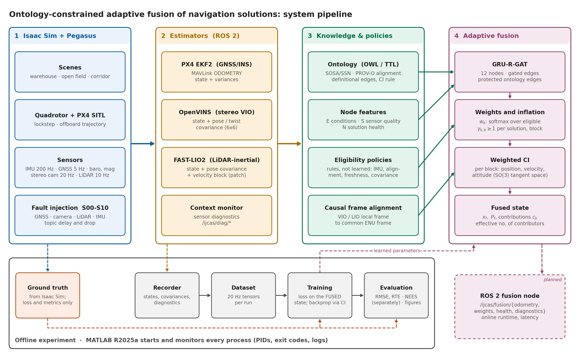
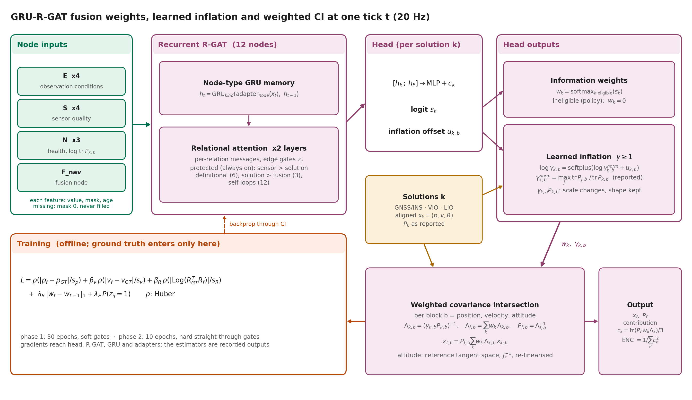
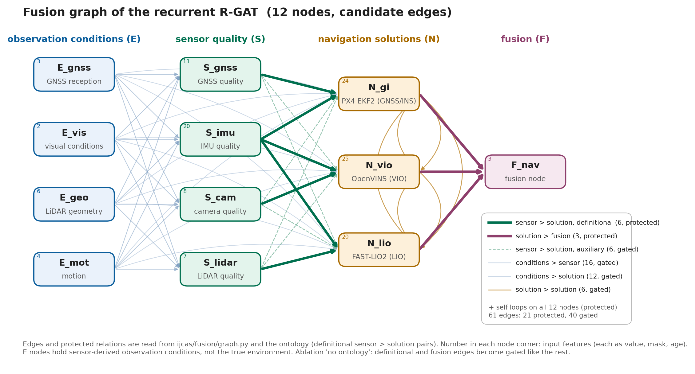
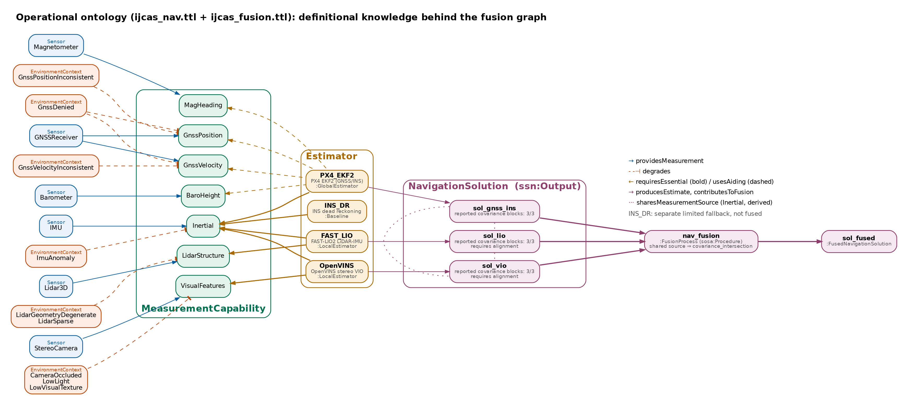
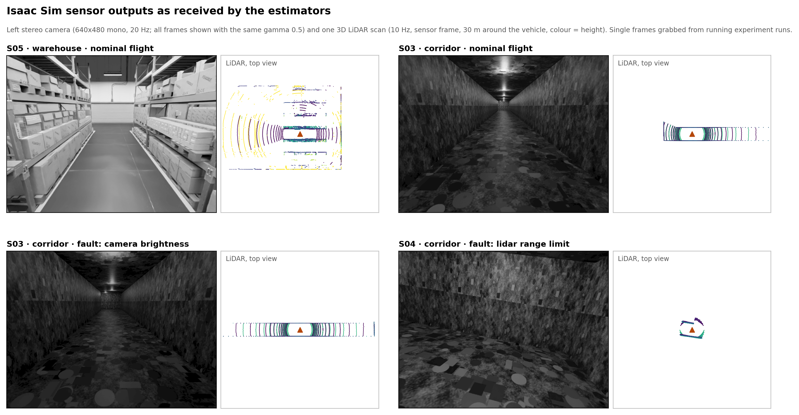

# 그림 모음 (문서·깃허브용)

온톨로지 제약 적응형 항법 해 융합(`fusion` 브랜치)의 구조와 시뮬레이션 환경을 보여 주는 그림이다.
모두 흰 배경 PNG(200 dpi)와 SVG로 저장한다. 그림 속 글자는 영문이다.
결과 수치는 들어 있지 않다. 아직 구현하지 않은 부분은 점선으로 그리고 *planned*로 표시했다.

## 1. 시스템 파이프라인



Isaac Sim + Pegasus에서 만든 센서 출력이 세 추정기로 들어간다. 세 추정기는 PX4 EKF2(GNSS/INS), OpenVINS(VIO), FAST-LIO2(LIO)이다.
각 추정기의 상태와 추정기가 **스스로 보고한 공분산**에 다음이 더해져 적응형 융합으로 들어간다.

- 온톨로지 제약
- 적격성 정책
- 진단 특징
- 좌표 정렬

아래 띠는 오프라인 실험 흐름이다. MATLAB R2025a가 각 프로세스를 시작하고 PID·종료 코드·로그를 관리한다.
참값(GT)은 학습 손실과 평가 지표에만 들어가고 융합 입력으로는 쓰지 않는다.
온라인 ROS 2 융합 노드(`/ijcas/fusion/*`)와 지연 측정은 아직 구현하지 않았다.

## 2. 융합 모델 (한 시점)



순환 R-GAT은 노드 종류별 GRU 메모리와 관계별 어텐션으로 이루어진다. 그 출력은 해마다 두 가지이다.

- 정보 가중치 w_k: 적격한 해들에 대한 softmax
- 공분산 팽창 계수 γ_k,b ≥ 1: 해와 블록마다 하나씩
  - log γ = softplus(log γ_norm + u)
  - γ_norm은 보고된 공분산의 대각합 비이다.

가중 공분산 교차(CI)는 위치·속도·자세 블록별로 계산하고, 자세는 접공간에서 다룬다.
손실은 **융합된 상태**와 GT 사이의 오차이며, CI를 거쳐 역전파된다. 코드 위치는 다음과 같다.

- 모델: `ijcas/fusion/weights.py`
- CI: `ijcas/fusion/ci.py`
- 학습: `ijcas/fusion/train.py`

## 3. R-GAT 융합 그래프



노드는 12개이다. 관측 조건 E 4개, 센서 품질 S 4개, 항법 해 N 3개, 융합 노드 F 1개이다.
후보 간선은 61개이며, 그중 21개가 보호 간선이고 40개는 게이트 간선이다. 보호 간선은 다음과 같다.

- 온톨로지의 정의적 센서→해 간선 6개
- 해→융합 간선 3개
- 자기 루프 12개

간선과 보호 관계는 `ijcas/fusion/graph.py`와 온톨로지에서 직접 읽어 그렸다.
'온톨로지 없음' 비교 실험에서는 보호 간선도 게이트 간선으로 바뀐다.

## 4. 운용 온톨로지



그림은 `ijcas/knowledge/ijcas_nav.ttl`과 `ijcas_fusion.ttl`을 rdflib로 읽어 다음 관계를 graphviz로 그린 것이다.

- 센서 → 측정 능력
- 측정 능력 ← 추정기: 필수(requiresEssential)와 보조(usesAiding)
- 항법 해 → 융합 과정

환경 맥락 가운데 열화시키는 능력이 같은 것은 한 노드로 묶었다(예: LowVisualTexture·LowLight·CameraOccluded → VisualFeatures).
세 해는 모두 IMU(Inertial)를 공유한다. 그래서 공분산 교차(CI)가 필요하다는 규칙이 성립한다(`sharesMeasurementSource`).
INS 추측항법은 융합에 넣지 않고 별도의 제한 모드로 둔다. graphviz 원본은 `ontology.dot`이다.

## 5. Isaac Sim 센서 출력



실험이 돌고 있는 중에 시뮬레이터 출력 토픽에서 프레임을 한 장씩 받아 그렸다.

- 왼쪽 스테레오 카메라 영상
- 3D LiDAR 한 바퀴 스캔을 위에서 본 모습

영상은 모두 같은 감마(0.5)로 표시했다. 프레임마다 밝기를 따로 맞추지 않았으므로 밝기 결함 프레임은 실제로 어둡게 보인다.

## 다시 만들기

```bash
# 1-4: 다이어그램 (코드·TTL에서 직접 생성)
python3 tools/make_doc_figures.py architecture   # model | graph | ontology

# 5: 실행 중인 시뮬레이션에서 센서 프레임 받기 (ROS 2 환경)
source env/ijcas_env.sh
python3 tools/capture_sensor_views.py --out <캡처 폴더> --minutes 60
python3 tools/make_doc_figures.py sensors --captures <캡처 폴더> --picks <run_tag,...>

# 6: 장면 렌더링 (Isaac Sim; 수집 배치와 동시에 돌리지 않는다)
for s in warehouse open_field corridor; do
  isaac/run_isaac.sh isaac/render_overview.py --scene $s --out <렌더 폴더>
done
python3 tools/make_doc_figures.py scenes --renders <렌더 폴더>
```
