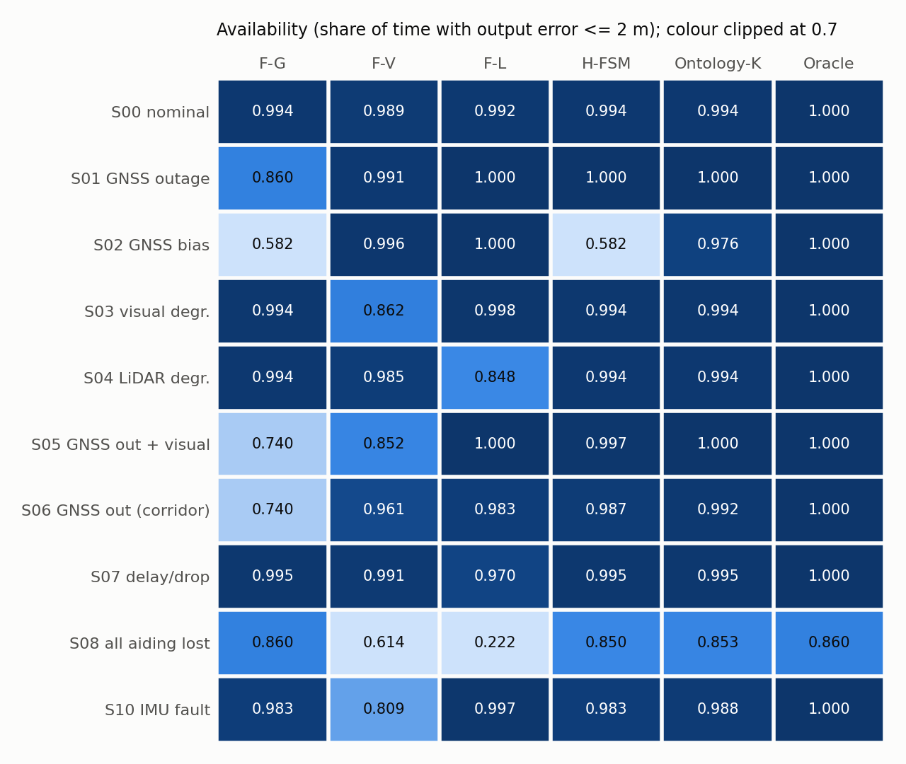
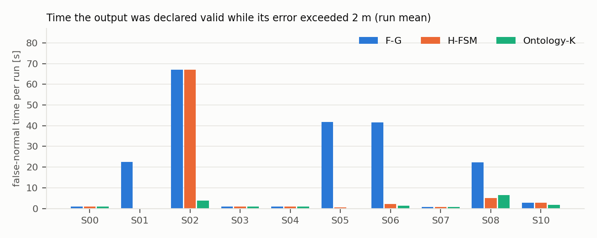

# G9 report: validation_calibrated
source: `results/g6/validation_calibrated`; failed runs: 0
Flat-K identical to Ontology-K on every run and metric: **True**

### Availability (output with error <= 2 m)

| scenario | runs | F-G | F-V | F-L | H-FSM | Ontology-K | Oracle |
|---|---|---|---|---|---|---|---|
| S00 nominal | 10 | 0.994 | 0.989 | 0.992 | 0.994 | 0.994 | 1.000 |
| S01 GNSS outage | 10 | 0.860 | 0.991 | 1.000 | 1.000 | 1.000 | 1.000 |
| S02 GNSS bias | 10 | 0.582 | 0.996 | 1.000 | 0.582 | 0.976 | 1.000 |
| S03 visual degr. | 10 | 0.994 | 0.862 | 0.998 | 0.994 | 0.994 | 1.000 |
| S04 LiDAR degr. | 10 | 0.994 | 0.985 | 0.848 | 0.994 | 0.994 | 1.000 |
| S05 GNSS out + visual | 10 | 0.740 | 0.852 | 1.000 | 0.997 | 1.000 | 1.000 |
| S06 GNSS out (corridor) | 10 | 0.740 | 0.961 | 0.983 | 0.987 | 0.992 | 1.000 |
| S07 delay/drop | 10 | 0.995 | 0.991 | 0.970 | 0.995 | 0.995 | 1.000 |
| S08 all aiding lost | 10 | 0.860 | 0.614 | 0.222 | 0.850 | 0.853 | 0.860 |
| S10 IMU fault | 10 | 0.983 | 0.809 | 0.997 | 0.983 | 0.988 | 1.000 |

### False-normal output time per run [s]

| scenario | runs | F-G | F-V | F-L | H-FSM | Ontology-K | Oracle |
|---|---|---|---|---|---|---|---|
| S00 nominal | 10 | 1.0 | 0.2 | 0.6 | 1.0 | 1.0 | 0.0 |
| S01 GNSS outage | 10 | 22.4 | 0.0 | 0.0 | 0.0 | 0.0 | 0.0 |
| S02 GNSS bias | 10 | 67.0 | 0.6 | 0.1 | 67.0 | 3.9 | 0.0 |
| S03 visual degr. | 10 | 0.9 | 0.2 | 0.0 | 0.9 | 0.9 | 0.0 |
| S04 LiDAR degr. | 10 | 1.0 | 0.0 | 0.6 | 1.0 | 1.0 | 0.0 |
| S05 GNSS out + visual | 10 | 41.7 | 0.0 | 0.0 | 0.4 | 0.0 | 0.0 |
| S06 GNSS out (corridor) | 10 | 41.7 | 1.3 | 2.0 | 2.2 | 1.3 | 0.0 |
| S07 delay/drop | 10 | 0.8 | 0.0 | 0.4 | 0.8 | 0.8 | 0.0 |
| S08 all aiding lost | 10 | 22.4 | 9.9 | 0.0 | 5.1 | 6.5 | 22.4 |
| S10 IMU fault | 10 | 2.7 | 12.3 | 0.0 | 2.7 | 1.8 | 0.0 |

### No-valid-nav time per run [s]

| scenario | runs | F-G | F-V | F-L | H-FSM | Ontology-K | Oracle |
|---|---|---|---|---|---|---|---|
| S00 nominal | 10 | 0.0 | 1.5 | 0.7 | 0.0 | 0.0 | 0.0 |
| S01 GNSS outage | 10 | 0.0 | 1.5 | 0.0 | 0.0 | 0.0 | 0.0 |
| S02 GNSS bias | 10 | 0.0 | 0.0 | 0.0 | 0.0 | 0.0 | 0.0 |
| S03 visual degr. | 10 | 0.0 | 21.9 | 0.4 | 0.0 | 0.0 | 0.0 |
| S04 LiDAR degr. | 10 | 0.0 | 2.5 | 23.7 | 0.0 | 0.0 | 0.0 |
| S05 GNSS out + visual | 10 | 0.0 | 23.6 | 0.0 | 0.0 | 0.0 | 0.0 |
| S06 GNSS out (corridor) | 10 | 0.0 | 5.0 | 0.8 | 0.0 | 0.0 | 0.0 |
| S07 delay/drop | 10 | 0.0 | 1.5 | 4.4 | 0.0 | 0.0 | 0.0 |
| S08 all aiding lost | 10 | 0.0 | 52.0 | 124.6 | 19.0 | 17.1 | 0.0 |
| S10 IMU fault | 10 | 0.0 | 18.2 | 0.4 | 0.0 | 0.1 | 0.0 |

### Switches per run

| scenario | runs | F-G | F-V | F-L | H-FSM | Ontology-K | Oracle |
|---|---|---|---|---|---|---|---|
| S00 nominal | 10 | 0.0 | 0.3 | 0.2 | 0.0 | 0.0 | 52.5 |
| S01 GNSS outage | 10 | 0.0 | 0.3 | 0.0 | 2.0 | 1.1 | 48.7 |
| S02 GNSS bias | 10 | 0.0 | 0.0 | 0.0 | 0.0 | 1.4 | 34.3 |
| S03 visual degr. | 10 | 0.0 | 5.8 | 0.2 | 0.0 | 0.0 | 47.9 |
| S04 LiDAR degr. | 10 | 0.0 | 0.5 | 0.4 | 0.0 | 0.0 | 47.7 |
| S05 GNSS out + visual | 10 | 0.0 | 1.0 | 0.0 | 2.5 | 9.9 | 34.5 |
| S06 GNSS out (corridor) | 10 | 0.0 | 1.0 | 0.4 | 2.0 | 1.0 | 43.7 |
| S07 delay/drop | 10 | 0.0 | 0.3 | 57.6 | 0.0 | 0.0 | 104.5 |
| S08 all aiding lost | 10 | 0.0 | 3.9 | 1.0 | 4.0 | 3.0 | 25.9 |
| S10 IMU fault | 10 | 0.0 | 5.0 | 0.2 | 0.0 | 1.2 | 48.2 |

### Paired difference comparator - Ontology-K, availability (mean, run-level bootstrap 95 % CI)

| scenario | F-G | F-V | F-L | H-FSM | Oracle |
|---|---|---|---|---|---|
| S00 nominal | +0.000 [+0.000, +0.000] | -0.004 [-0.019, +0.012] | -0.001 [-0.013, +0.008] | +0.000 [+0.000, +0.000] | +0.006 [+0.000, +0.018] |
| S01 GNSS outage | -0.140 [-0.219, -0.063] | -0.009 [-0.018, +0.000] | +0.000 [+0.000, +0.000] | -0.000 [-0.000, +0.000] | +0.000 [+0.000, +0.000] |
| S02 GNSS bias | -0.394 [-0.415, -0.370] | +0.020 [+0.016, +0.025] | +0.024 [+0.019, +0.030] | -0.394 [-0.415, -0.370] | +0.024 [+0.019, +0.030] |
| S03 visual degr. | +0.000 [+0.000, +0.000] | -0.133 [-0.301, -0.021] | +0.003 [-0.007, +0.017] | +0.000 [+0.000, +0.000] | +0.006 [+0.000, +0.017] |
| S04 LiDAR degr. | +0.000 [+0.000, +0.000] | -0.009 [-0.024, +0.010] | -0.145 [-0.363, +0.003] | +0.000 [+0.000, +0.000] | +0.006 [+0.000, +0.019] |
| S05 GNSS out + visual | -0.260 [-0.266, -0.254] | -0.148 [-0.237, -0.059] | +0.000 [+0.000, +0.000] | -0.003 [-0.008, -0.000] | +0.000 [+0.000, +0.000] |
| S06 GNSS out (corridor) | -0.252 [-0.266, -0.235] | -0.031 [-0.032, -0.030] | -0.009 [-0.047, +0.022] | -0.005 [-0.014, -0.000] | +0.008 [+0.000, +0.025] |
| S07 delay/drop | +0.000 [+0.000, +0.000] | -0.004 [-0.014, +0.004] | -0.025 [-0.038, -0.011] | +0.000 [+0.000, +0.000] | +0.005 [+0.000, +0.015] |
| S08 all aiding lost | +0.008 [+0.001, +0.013] | -0.239 [-0.359, -0.135] | -0.631 [-0.671, -0.592] | -0.003 [-0.016, +0.008] | +0.008 [+0.001, +0.013] |
| S10 IMU fault | -0.005 [-0.017, +0.001] | -0.178 [-0.356, -0.035] | +0.009 [-0.004, +0.027] | -0.005 [-0.017, +0.001] | +0.012 [+0.001, +0.029] |

### Paired difference comparator - Ontology-K, false-normal time [s]

| scenario | F-G | F-V | F-L | H-FSM | Oracle |
|---|---|---|---|---|---|
| S00 nominal | +0.000 [+0.000, +0.000] | -0.820 [-2.460, +0.000] | -0.440 [-1.320, +0.000] | +0.000 [+0.000, +0.000] | -0.970 [-2.910, +0.000] |
| S01 GNSS outage | +22.410 [+10.050, +35.110] | +0.000 [+0.000, +0.000] | +0.000 [+0.000, +0.000] | +0.030 [+0.000, +0.060] | +0.000 [+0.000, +0.000] |
| S02 GNSS bias | +63.060 [+59.230, +66.550] | -3.280 [-4.070, -2.610] | -3.840 [-4.830, -3.030] | +63.060 [+59.230, +66.550] | -3.900 [-4.860, -3.120] |
| S03 visual degr. | +0.000 [+0.000, +0.000] | -0.680 [-2.310, +0.270] | -0.920 [-2.760, +0.000] | +0.000 [+0.000, +0.000] | -0.920 [-2.760, +0.000] |
| S04 LiDAR degr. | +0.000 [+0.000, +0.000] | -1.000 [-3.000, +0.000] | -0.440 [-1.320, +0.000] | +0.000 [+0.000, +0.000] | -1.000 [-3.000, +0.000] |
| S05 GNSS out + visual | +41.730 [+40.740, +42.670] | +0.000 [+0.000, +0.000] | +0.000 [+0.000, +0.000] | +0.450 [+0.040, +1.230] | +0.000 [+0.000, +0.000] |
| S06 GNSS out (corridor) | +40.370 [+37.630, +42.650] | +0.000 [+0.000, +0.000] | +0.660 [-3.930, +5.910] | +0.840 [+0.070, +2.290] | -1.310 [-3.930, +0.000] |
| S07 delay/drop | +0.000 [+0.000, +0.000] | -0.810 [-2.430, +0.000] | -0.420 [-1.260, +0.000] | +0.000 [+0.000, +0.000] | -0.810 [-2.430, +0.000] |
| S08 all aiding lost | +15.860 [+14.990, +16.960] | +3.370 [-2.330, +10.470] | -6.530 [-8.650, -4.340] | -1.420 [-3.220, +0.720] | +15.860 [+14.990, +16.960] |
| S10 IMU fault | +0.950 [+0.000, +2.750] | +10.500 [-0.930, +24.930] | -1.790 [-4.450, +0.000] | +0.950 [+0.000, +2.750] | -1.790 [-4.450, +0.000] |

